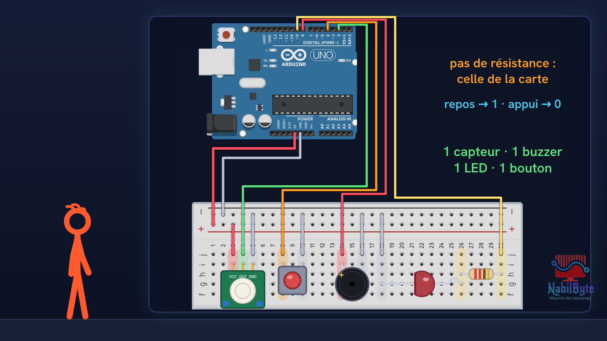
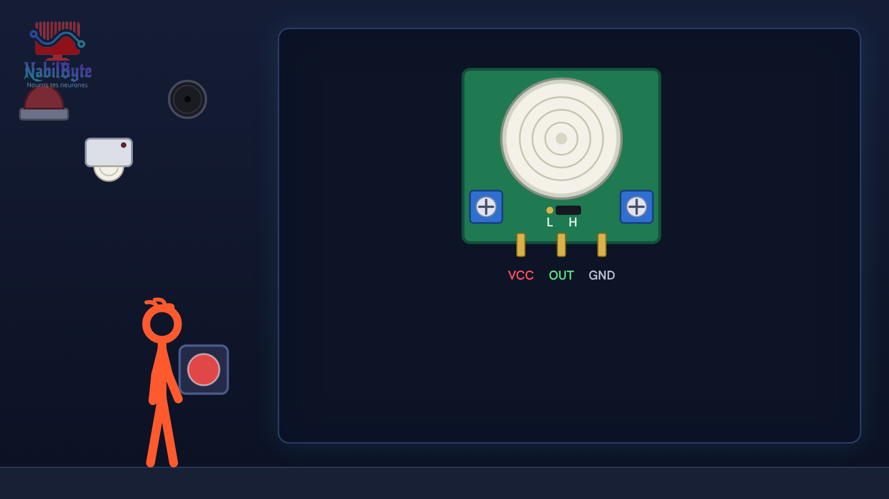
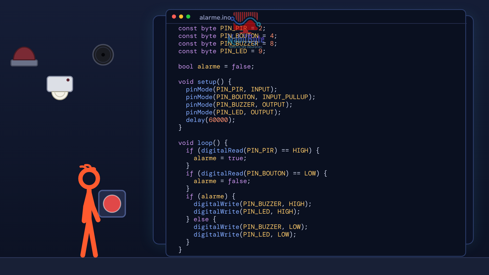

# Tutoriel Arduino n°37 : une alarme anti-intrusion avec un capteur de mouvement PIR (HC-SR501, buzzer, LED, bouton) 🚨

Dans ce tutoriel Arduino n°37, on fabrique une alarme anti-intrusion : quand quelqu'un passe devant la carte, un buzzer sonne et une LED rouge s'allume, et l'alarme continue jusqu'à ce qu'on appuie sur un bouton. Avec un capteur de mouvement PIR (module HC-SR501), une carte Arduino Uno, un buzzer actif, une LED et un bouton. Une vidéo pensée pour les débutants : la théorie d'abord, doucement, puis le montage et le code, avec deux essais ratés expliqués.

## Le montage

## La démo

## Le code

- [`arduino_alarme_pir`](arduino_alarme_pir/arduino_alarme_pir.ino)

Carte : Arduino Uno. Dans l'IDE Arduino, ouvre le fichier `.ino` (le dossier du croquis garde le même nom que le fichier).

## Matériel

carte Arduino Uno, module capteur de mouvement PIR HC-SR501, buzzer actif 5 V, LED rouge, résistance de 220 Ω, bouton poussoir, platine d'essai, fils, câble USB.

Animation et voix de synthèse de la chaîne NabilByte.
