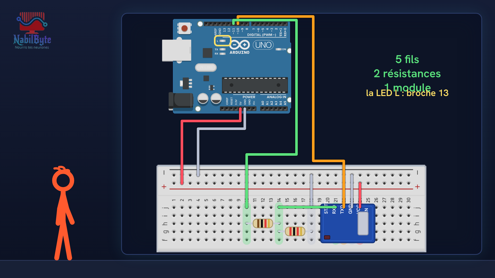
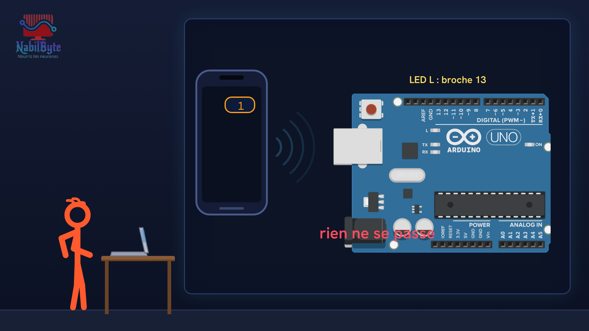
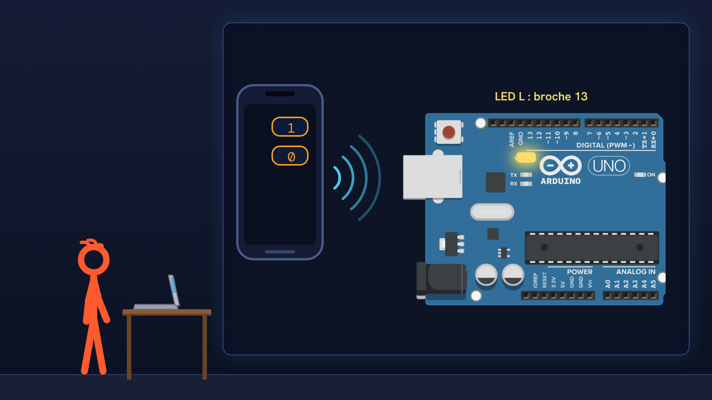

# Tutoriel Arduino n°36 : Arduino et Bluetooth, commander une LED avec son téléphone (HC-05) 📱

Dans ce tutoriel Arduino n°36, on commande une LED avec un téléphone, sans aucun fil : grâce au Bluetooth. Avec un module HC-05, une carte Arduino Uno et une application gratuite sur Android, on tape 1 pour allumer la LED, 0 pour l'éteindre, et la carte répond au téléphone. Une vidéo pensée pour les débutants : la théorie d'abord, doucement, puis le montage et le code, avec deux essais ratés expliqués.

## Le montage

## La démo

## Le code

- [`arduino_bluetooth`](arduino_bluetooth/arduino_bluetooth.ino)

Carte : Arduino Uno. Dans l'IDE Arduino, ouvre le fichier `.ino` (le dossier du croquis garde le même nom que le fichier).

## Matériel

carte Arduino Uno, module Bluetooth HC-05 (ou HC-06), platine d'essai, résistance de 1 kΩ, résistance de 2 kΩ (ou deux résistances de 1 kΩ en série), fils, câble USB, téléphone Android avec l'application Serial Bluetooth Terminal.

Animation et voix de synthèse de la chaîne NabilByte.
