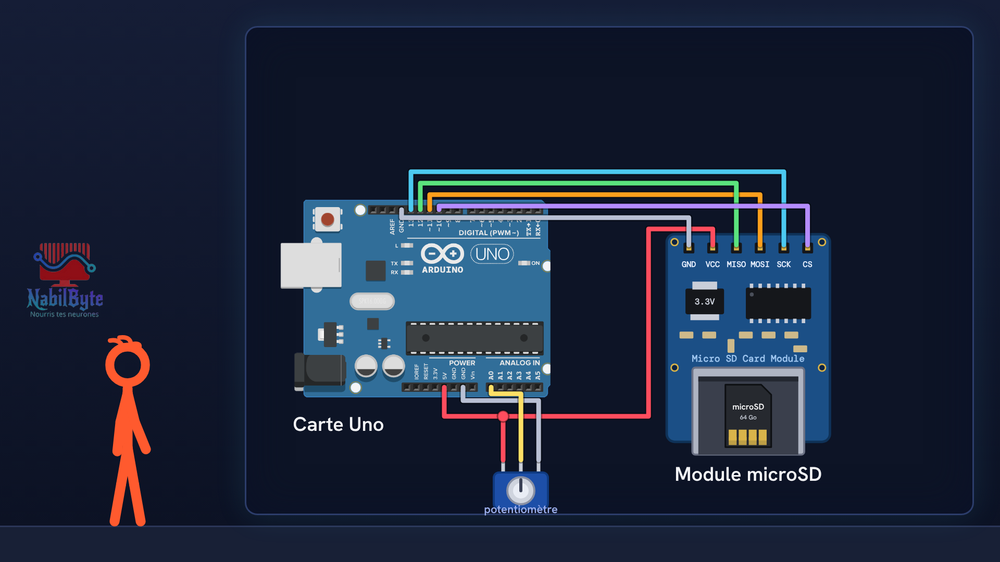
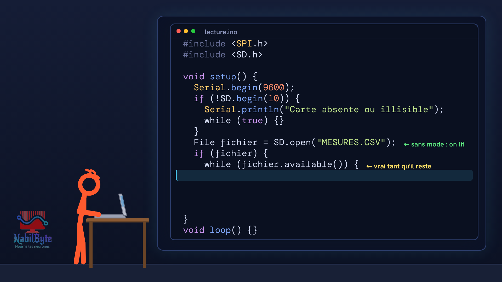
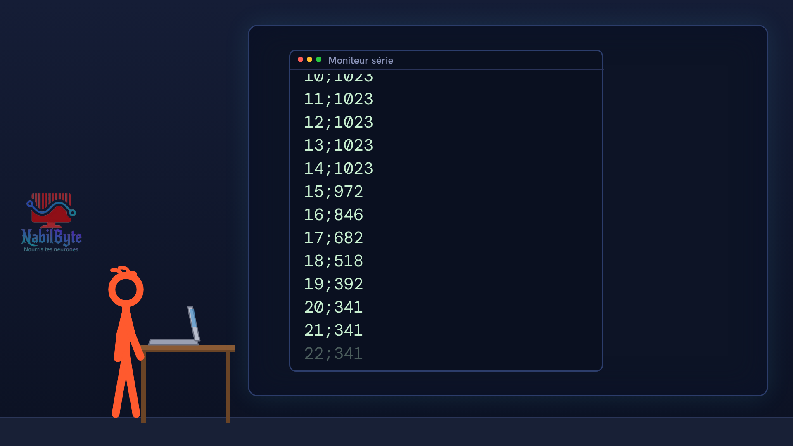

# Tutoriel Arduino n°30 : la carte SD, écrire et lire des fichiers (module microSD, FAT32, enregistreur de données) 💾

Dans ce tutoriel Arduino n°30, une carte Arduino Uno écrit chaque seconde la valeur d'un potentiomètre dans un fichier sur une carte SD : un vrai enregistreur de données (data logger). Une vidéo pensée pour les débutants : la théorie d'abord, doucement, puis le montage et le code, avec deux essais ratés expliqués.

## Le montage

## La démo

## Le code

- [`arduino_carte_sd_1`](arduino_carte_sd_1/arduino_carte_sd_1.ino)
- [`arduino_carte_sd_2`](arduino_carte_sd_2/arduino_carte_sd_2.ino)

Carte : Arduino Uno. Dans l'IDE Arduino, ouvre le fichier `.ino` (le dossier du croquis garde le même nom que le fichier).

## Bibliothèques à installer

Gestionnaire de bibliothèques de l'IDE : « SD ».

Animation et voix de synthèse de la chaîne NabilByte.
