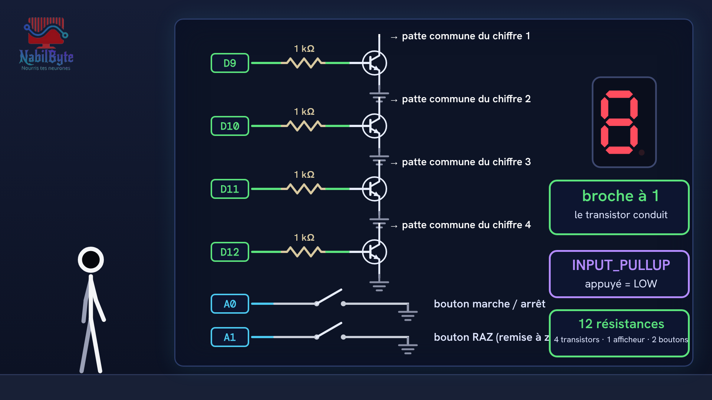
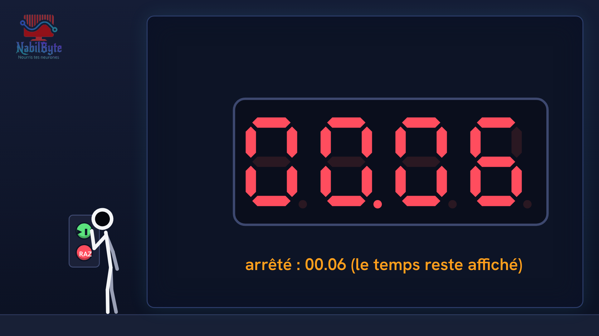
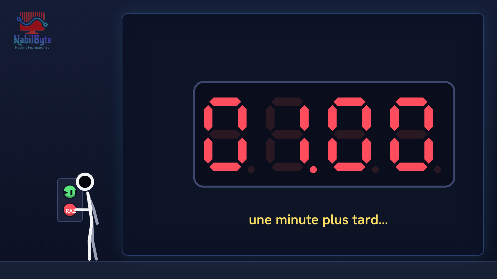

# Tutoriel Arduino n°28 : un chronomètre sur afficheur 7 segments (multiplexage, transistors, millis) ⏱️

Dans ce tutoriel Arduino n°28, on fabrique un chronomètre : un afficheur à 4 chiffres et 7 segments qui compte les minutes et les secondes, avec un bouton marche / arrêt et un bouton de remise à zéro. Une vidéo pensée pour les débutants, où chaque notion est expliquée doucement avant d'être utilisée.

## Le montage

## La démo

## Le code

- [`arduino_chronometre`](arduino_chronometre/arduino_chronometre.ino)

Carte : Arduino Uno. Dans l'IDE Arduino, ouvre le fichier `.ino` (le dossier du croquis garde le même nom que le fichier).

Animation et voix de synthèse de la chaîne NabilByte.
