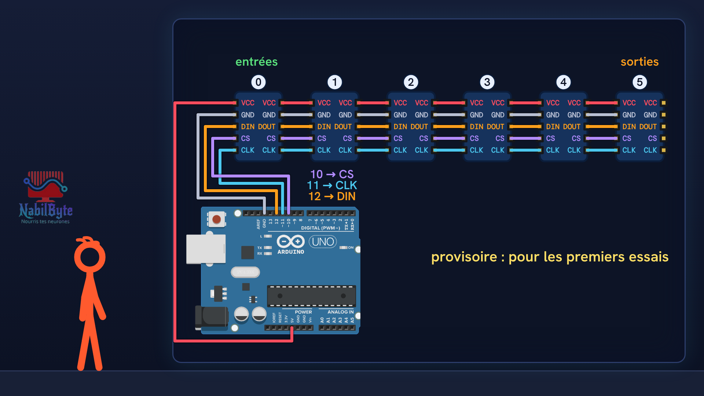
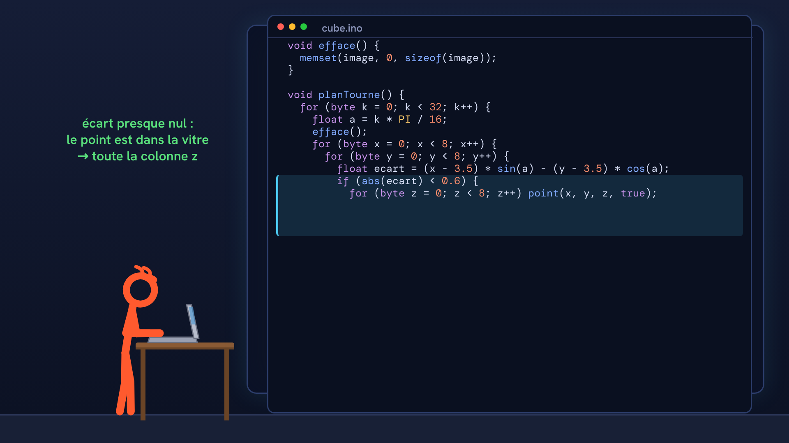
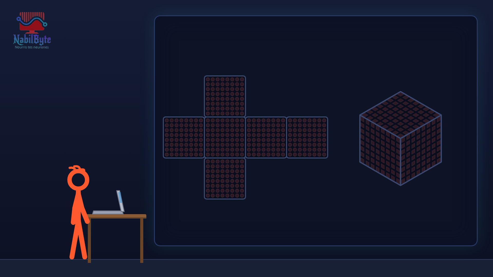

# Tutoriel Arduino n°39 : un cube de LED avec 6 matrices MAX7219 (chaînage, alimentation, effets) 💡

Tutoriel Arduino n°39 : on fabrique un cube de LED. Six matrices 8×8 MAX7219 forment les six faces d'un cube creux, et une carte Arduino Uno y fait courir un plan qui tourne, de la pluie, une spirale et un mot qui fait le tour. Pour les débutants : théorie, montage, code, et trois essais ratés expliqués.

## Le montage

## La démo

## Le code

- [`arduino_cube_led`](arduino_cube_led/arduino_cube_led.ino)

Carte : Arduino Uno. Dans l'IDE Arduino, ouvre le fichier `.ino` (le dossier du croquis garde le même nom que le fichier).

## Bibliothèques à installer

Gestionnaire de bibliothèques de l'IDE : « LedControl ».

## Matériel

Arduino Uno, six modules 8×8 MAX7219, un cube creux (carton ou impression 3D), alimentation 5 V 3 A, fils, bibliothèque LedControl.

Animation et voix de synthèse de la chaîne NabilByte.
