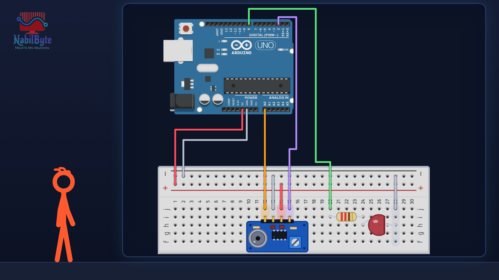

# Tutoriel Arduino n°48 : un détecteur de claquement, une lampe qu'on allume en tapant dans ses mains 👏

Tutoriel Arduino n°48 : on fabrique un interrupteur qu'on commande en tapant dans ses mains, avec un module capteur de son (micro à électret). Tu vois comment un micro transforme le son en tension, pourquoi une seule lecture rate presque toujours le sommet de la vague, comment mesurer la force d'un bruit (l'amplitude sur une fenêtre de 50 ms avec min et max), comment choisir un seuil entre la voix et le clap, comment ne compter qu'une fois chaque clap (temps mort avec millis), puis comment reconnaître deux claps de suite. Pour les débutants : théorie, montage, code, et quatre erreurs expliquées (une lecture isolée, un seuil trop bas, un clap compté trois fois, la sortie DO inversée).

## Le montage

## La démo

## Le code

Dans l'ordre du tutoriel :

1. [`son_lecture_brute`](son_lecture_brute/son_lecture_brute.ino) : une lecture toutes les 100 ms et un seuil de 600 (rate presque tous les claps : erreur n°1)
2. [`son_amplitude`](son_amplitude/son_amplitude.ino) : l'amplitude (maxi − mini) sur une fenêtre de 50 ms, affichée dans le moniteur série
3. [`son_seuil`](son_seuil/son_seuil.ino) : la LED s'allume quand l'amplitude dépasse le seuil de 150 (avec un seuil de 20 : erreur n°2)
4. [`son_interrupteur`](son_interrupteur/son_interrupteur.ino) : un clap, un changement, avec un temps mort de 400 ms (sans lui : erreur n°3)
5. [`son_test_do`](son_test_do/son_test_do.ino) : affiche le niveau de la broche 2 (sortie numérique DO) dans le moniteur série
6. [`son_sortie_numerique`](son_sortie_numerique/son_sortie_numerique.ino) : la même chose avec la sortie DO (avec `HIGH` au lieu de `LOW` : erreur n°4)
7. [`son_double_clap`](son_double_clap/son_double_clap.ino) : deux claps de suite (entre 150 ms et 800 ms) pour allumer ou éteindre

Carte : Arduino Uno. Dans l'IDE Arduino, ouvre le fichier `.ino` (le dossier du croquis garde le même nom que le fichier).

## Matériel

Arduino Uno, platine d'essai, module capteur de son (sorties AO et DO, comme le KY-038), 1 LED, 1 résistance 220 Ω, fils, câble USB. Les nombres montrés (seize en silence, soixante-seize pour la voix, plus de sept cents pour un clap) sont ceux de mon module : sur le tien ils seront différents, ton moniteur série te donnera les bons. Ce montage allume une simple LED : pour une vraie lampe sur le courant de la maison, utilise un module relais (il y a un tutoriel sur la chaîne).

Animation et voix de synthèse de la chaîne NabilByte.
