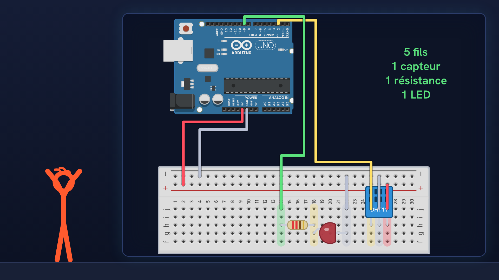
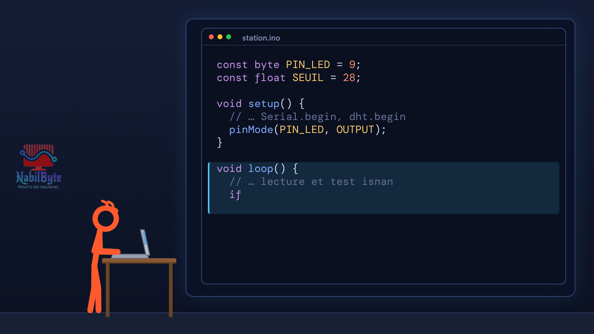

# Tutoriel Arduino n°32 : le capteur de température et d'humidité DHT11, une station météo (DHT sensor library, isnan, alerte LED) 🌡️

Dans ce tutoriel Arduino n°32, une carte Arduino Uno lit la température et l'humidité d'une pièce avec le capteur DHT11 : les mesures s'affichent sur le moniteur série, et une LED s'allume dès qu'il fait plus de 28 °C. Une vidéo pensée pour les débutants : la théorie d'abord, doucement, puis le montage et le code, avec deux essais ratés expliqués.

## Le montage

## La démo

## Le code

- [`arduino_dht11_temperature`](arduino_dht11_temperature/arduino_dht11_temperature.ino)

Carte : Arduino Uno. Dans l'IDE Arduino, ouvre le fichier `.ino` (le dossier du croquis garde le même nom que le fichier).

## Bibliothèques à installer

Gestionnaire de bibliothèques de l'IDE : « DHT sensor library ».

Animation et voix de synthèse de la chaîne NabilByte.
