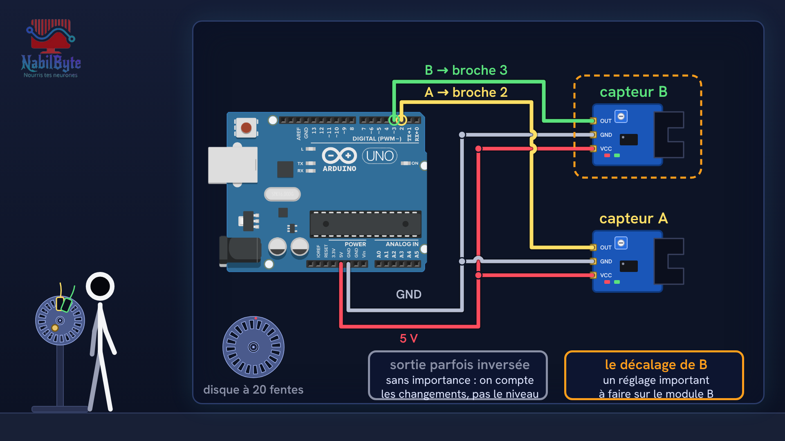
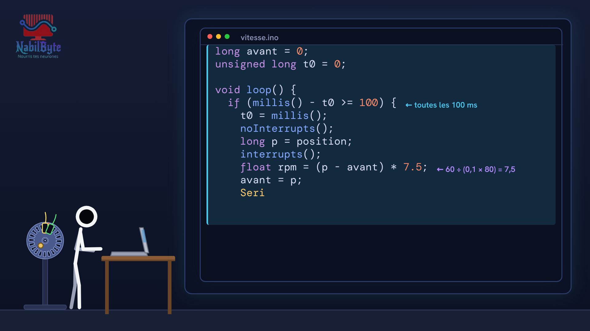
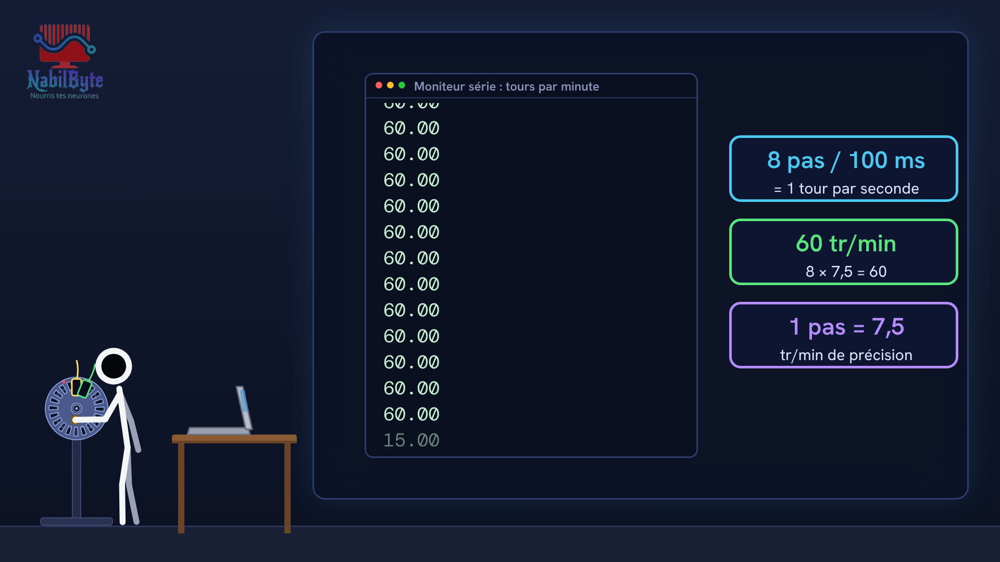

# Tutoriel Arduino n°25 : l'encodeur optique expliqué (disque à fentes, quadrature, interruptions) ⚙️

Dans ce tutoriel Arduino n°25, on comprend et on utilise un encodeur optique : le capteur qui dit de combien un axe a tourné, dans quel sens et à quelle vitesse. D'abord la théorie, avec des schémas et de vrais chiffres, puis la pratique avec une carte Arduino Uno, deux modules à fourche optique et un disque à 20 fentes.

## Le montage

## La démo

## Le code

- [`arduino_encodeur_optique_1`](arduino_encodeur_optique_1/arduino_encodeur_optique_1.ino)
- [`arduino_encodeur_optique_2`](arduino_encodeur_optique_2/arduino_encodeur_optique_2.ino)

Carte : Arduino Uno. Dans l'IDE Arduino, ouvre le fichier `.ino` (le dossier du croquis garde le même nom que le fichier).

Animation et voix de synthèse de la chaîne NabilByte.
