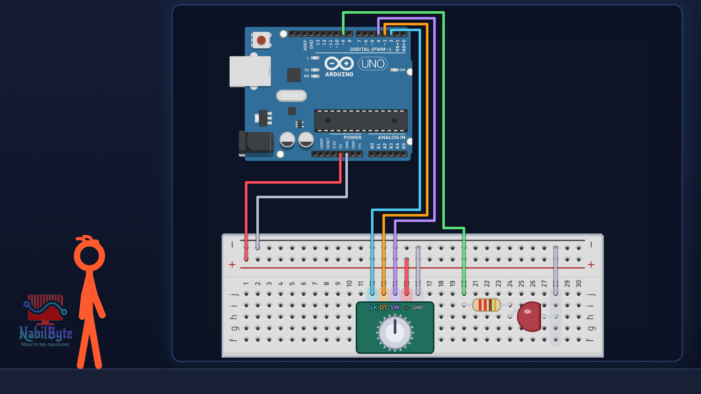
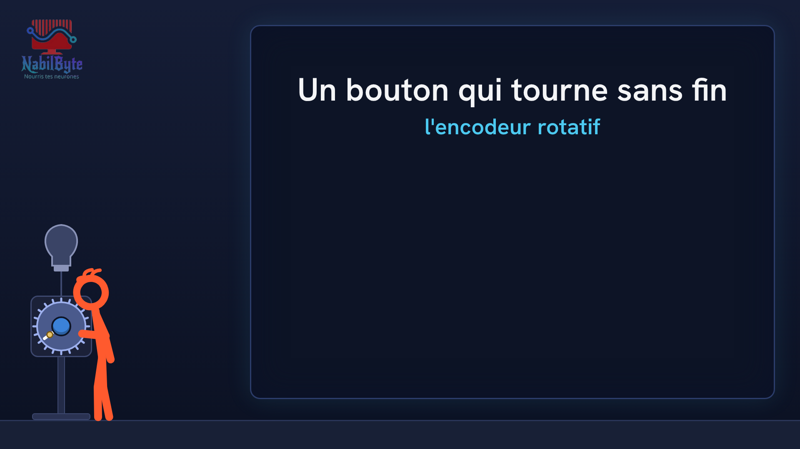

# Tutoriel Arduino n°45 : encodeur rotatif KY-040, un bouton sans fin pour régler une lampe 🎛️

Tutoriel Arduino n°45 : on fabrique un bouton qui tourne sans jamais s'arrêter pour régler la luminosité d'une lampe, avec un encodeur rotatif KY-040. Tu vois comment l'encodeur donne le sens de rotation (CLK et DT), pourquoi un contact mécanique rebondit et compte plusieurs fois, comment un byte qui déborde éteint la lampe d'un coup, et comment lire le bouton poussoir de l'axe sans qu'il bégaie. Pour les débutants : théorie, montage, code, et trois erreurs expliquées (rebonds, débordement d'un byte, appui qui se répète).

## Le montage

## La démo

## Le code

Le programme final est `encodeur_final` ; les autres sont les étapes (et les erreurs) montrées dans la vidéo : `encodeur_lecture_brute` (les rebonds comptent plusieurs fois), `encodeur_antirebond`, `encodeur_octet_deborde` (le byte qui déborde), `encodeur_luminosite`, `encodeur_bouton_rate` (l'appui qui se répète). Broches : CLK = 2, DT = 3, SW = 4, LED = 9.

- [`encodeur_antirebond`](encodeur_antirebond/encodeur_antirebond.ino)
- [`encodeur_bouton_rate`](encodeur_bouton_rate/encodeur_bouton_rate.ino)
- [`encodeur_final`](encodeur_final/encodeur_final.ino)
- [`encodeur_lecture_brute`](encodeur_lecture_brute/encodeur_lecture_brute.ino)
- [`encodeur_luminosite`](encodeur_luminosite/encodeur_luminosite.ino)
- [`encodeur_octet_deborde`](encodeur_octet_deborde/encodeur_octet_deborde.ino)

Carte : Arduino Uno. Dans l'IDE Arduino, ouvre le fichier `.ino` (le dossier du croquis garde le même nom que le fichier).

## Matériel

Arduino Uno, platine d'essai, module encodeur rotatif KY-040, LED, résistance 220 Ω, fils, câble USB. Vérifie les noms des broches écrits sur TON module : l'ordre peut changer selon les modèles.

Animation et voix de synthèse de la chaîne NabilByte.
