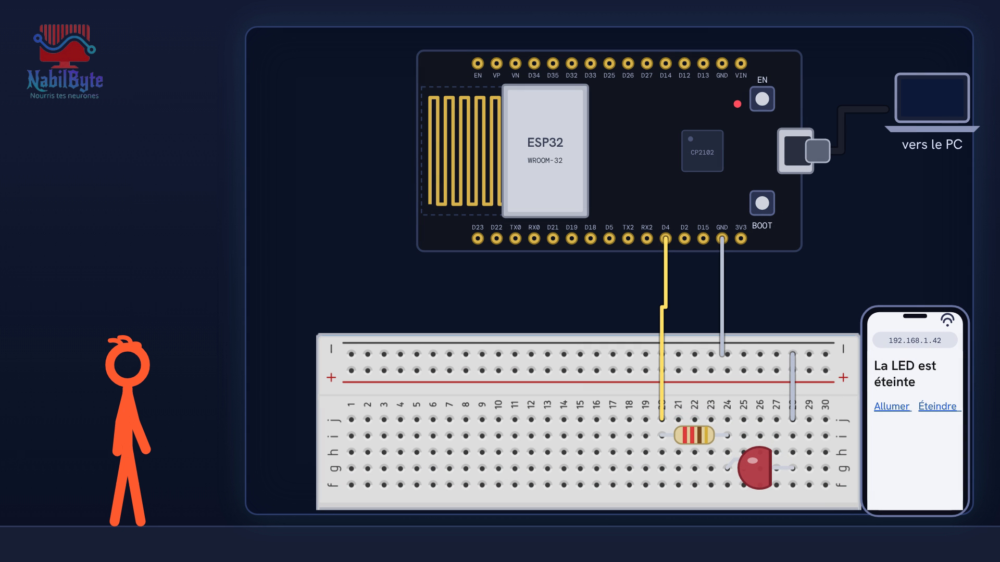
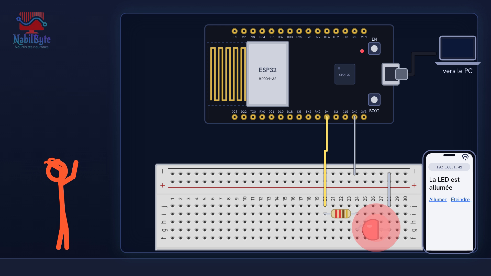

# Tutoriel Arduino n°43 : ESP32, une page web pour allumer une LED en Wi-Fi 📶

Tutoriel Arduino n°43 : on fabrique une télécommande pour une LED sans télécommande ni fil, avec une carte ESP32 : une simple page web qu'on ouvre sur un téléphone. Tu vois comment marche une page web (client, serveur, adresse IP, port, demande GET, réponse HTML), comment l'ESP32 se connecte au Wi-Fi, comment écrire un serveur avec la bibliothèque WebServer et des boutons qui allument et éteignent la LED. Pour les débutants : théorie, montage, code, et quatre erreurs expliquées (réseau à 5 GHz, loop vide, page blanche « OK », téléphone en 4G).

## Le montage

## La démo

## Le code

- [`page_commande_led`](page_commande_led/page_commande_led.ino)
- [`serveur_bonjour`](serveur_bonjour/serveur_bonjour.ino)
- [`wifi_connexion`](wifi_connexion/wifi_connexion.ino)

Carte : **ESP32 Dev Module**. Dans l'IDE Arduino : Fichier → Préférences → « URL de gestionnaires de cartes supplémentaires » : `https://espressif.github.io/arduino-esp32/package_esp32_index.json`, puis Outils → Gestionnaire de cartes → installer « esp32 by Espressif Systems ». Ouvre ensuite le fichier `.ino` (le dossier du croquis garde le même nom que le fichier) et remplace `MaBox` et `motdepasse` par le nom (2,4 GHz) et le mot de passe de ton Wi-Fi.

## Matériel

carte ESP32 (kit de développement à 30 broches, ESP32 Dev Module), platine d'essai, LED, résistance 220 Ω, 2 fils, câble USB (qui transmet les données), un téléphone et le Wi-Fi de la maison (2,4 GHz).

Animation et voix de synthèse de la chaîne NabilByte.
