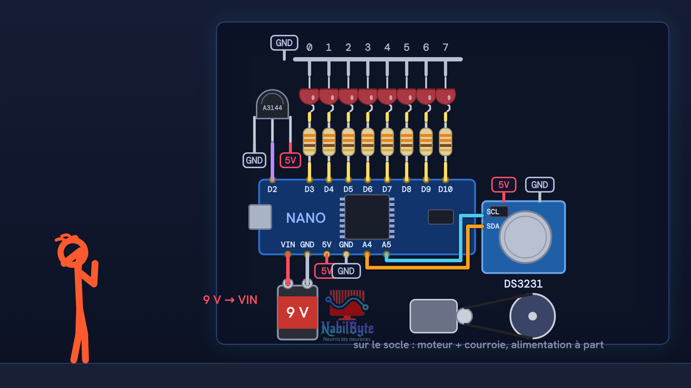
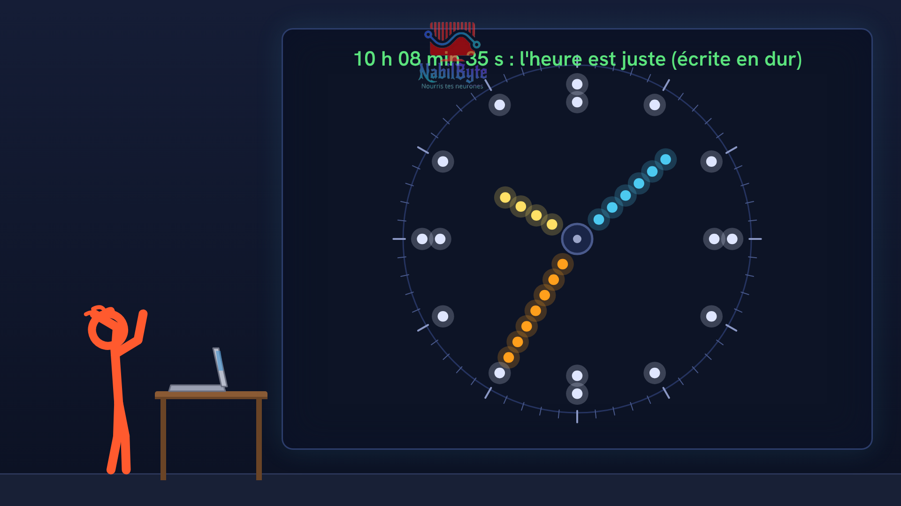
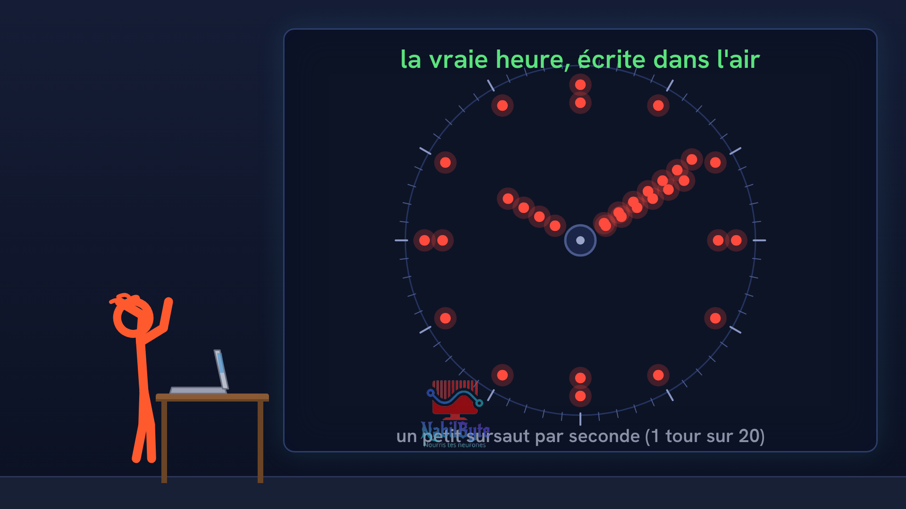

# Tutoriel Arduino n°49 : horloge POV, des LED qui tournent écrivent l'heure dans l'air 🕒

Tutoriel Arduino n°49 : on fabrique une horloge POV (« rotating clock ») : une barre de 8 LED qui tourne à 20 tours par seconde écrit l'heure dans l'air, sans écran. Tu vois pourquoi l'œil garde une image (la persistance de la vision), comment couper un tour en 60 colonnes de 6° avec un octet par colonne, comment un capteur à effet Hall et une interruption mesurent la durée de chaque tour, puis comment lire la vraie heure sur un module DS3231. Pour les débutants : théorie, montage, code, et trois erreurs expliquées (l'image qui tourne toute seule, l'heure à l'envers, le repère de midi effacé par la lecture de l'heure).

## Le montage

## La démo

## Le code

- [`pov_capteur`](pov_capteur/pov_capteur.ino)
- [`pov_horloge`](pov_horloge/pov_horloge.ino)
- [`pov_rtc_chaque_tour`](pov_rtc_chaque_tour/pov_rtc_chaque_tour.ino)
- [`pov_sans_capteur`](pov_sans_capteur/pov_sans_capteur.ino)
- [`pov_sens`](pov_sens/pov_sens.ino)

Carte : Arduino Uno. Dans l'IDE Arduino, ouvre le fichier `.ino` (le dossier du croquis garde le même nom que le fichier).

## Bibliothèques à installer

Gestionnaire de bibliothèques de l'IDE : « RTClib ».

## Matériel

carte Arduino Nano (ou Uno : même puce et mêmes broches), 8 LED, 8 résistances 330 Ω, capteur à effet Hall A3144 et un petit aimant, module horloge DS3231, pile 9 V, petit moteur avec courroie et son alimentation, plaque à trous, fils. Les durées (un tour, la lecture du DS3231 de l'ordre de 1,5 ms) sont des ordres de grandeur : chez toi elles seront un peu différentes, le montage complet n'a pas été essayé sur une carte pour cette vidéo, le code compile et la partie sans horloge a été jouée sur un simulateur.

Animation et voix de synthèse de la chaîne NabilByte.
