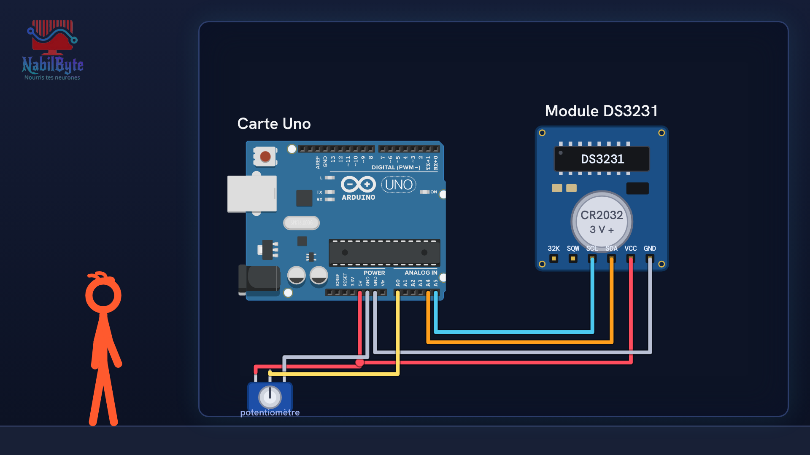
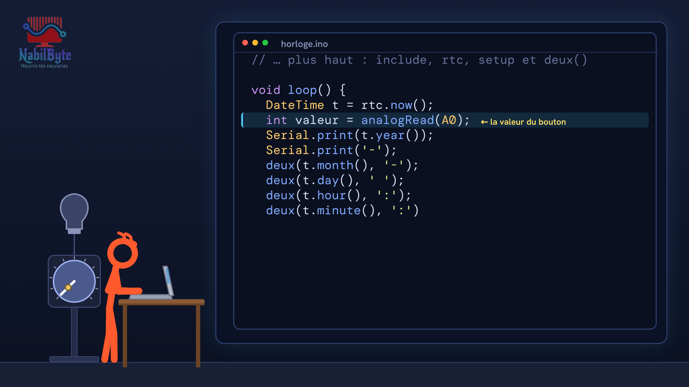
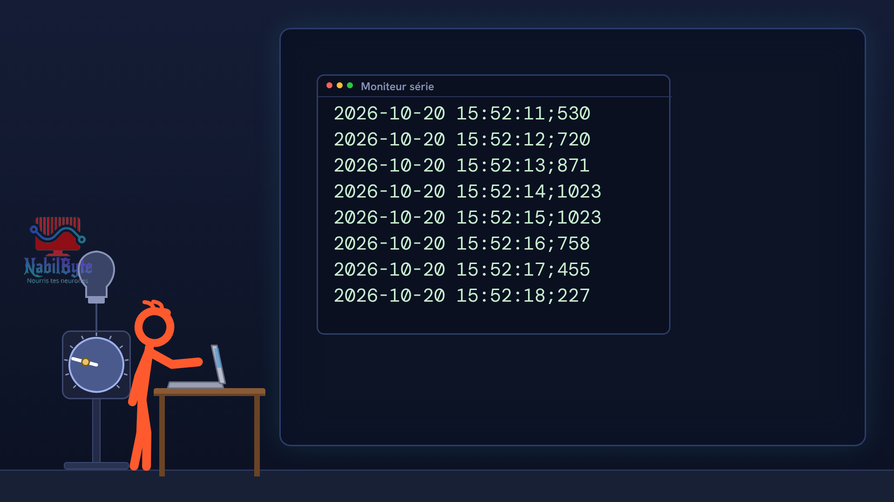

# Tutoriel Arduino n°35 : l'horloge temps réel DS3231, la date et l'heure même débranchée (RTClib, pile, BCD) ⏰

Dans ce tutoriel Arduino n°35, une carte Arduino Uno lit la date et l'heure dans une horloge temps réel DS3231, qui continue de compter même quand la carte est débranchée. Une vidéo pensée pour les débutants : la théorie d'abord, doucement, puis le montage et le code, avec deux essais ratés expliqués.

## Le montage

## La démo

## Le code

- [`arduino_horloge_rtc`](arduino_horloge_rtc/arduino_horloge_rtc.ino)

Carte : Arduino Uno. Dans l'IDE Arduino, ouvre le fichier `.ino` (le dossier du croquis garde le même nom que le fichier).

## Bibliothèques à installer

Gestionnaire de bibliothèques de l'IDE : « RTClib ».

Animation et voix de synthèse de la chaîne NabilByte.
