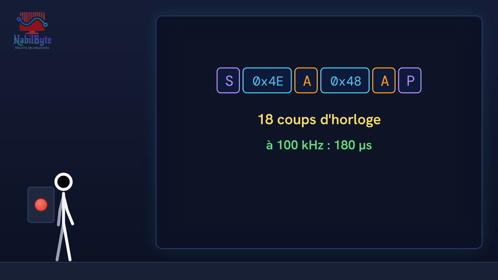
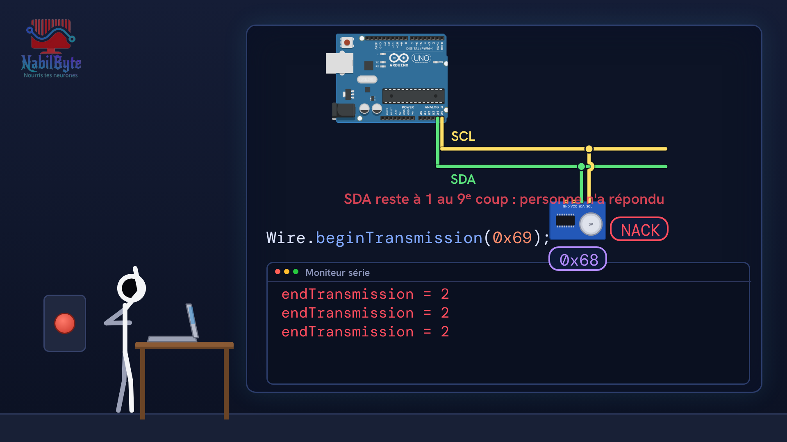
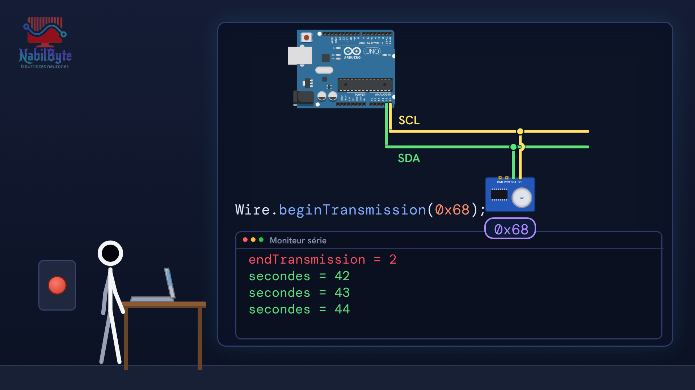

# Tutoriel Arduino n°24 : le protocole I2C en détail (START, STOP, ACK, trames, signaux) 🔬

Dans ce tutoriel Arduino n°24, on ouvre le capot du protocole I2C (I²C) : au lieu de seulement appeler Wire.h, on regarde ce qui se passe réellement sur les deux fils, SDA (données) et SCL (horloge), avec un analyseur logique, des chronogrammes et de vrais chiffres. Ensuite seulement, on retrouve le code de l'Arduino.

## Le montage

## La démo

## Le code

- [`arduino_i2c_en_detail`](arduino_i2c_en_detail/arduino_i2c_en_detail.ino)

Carte : Arduino Uno. Dans l'IDE Arduino, ouvre le fichier `.ino` (le dossier du croquis garde le même nom que le fichier).

Animation et voix de synthèse de la chaîne NabilByte.
