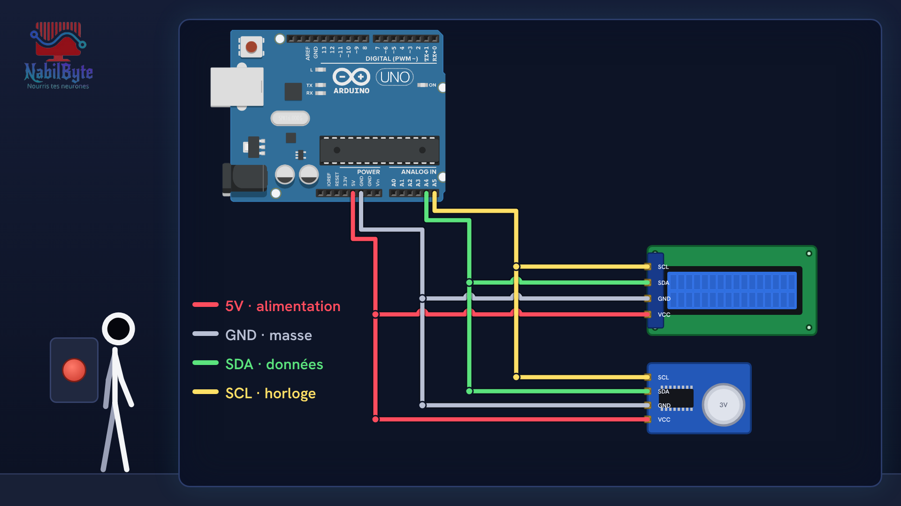
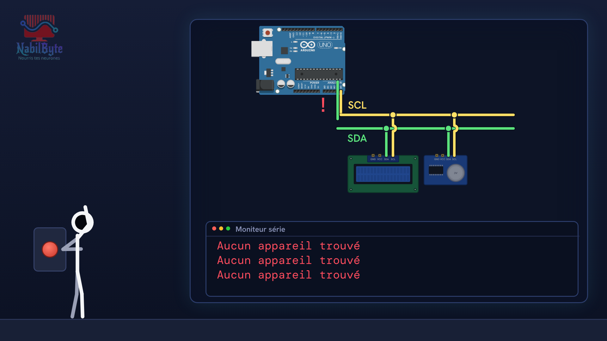
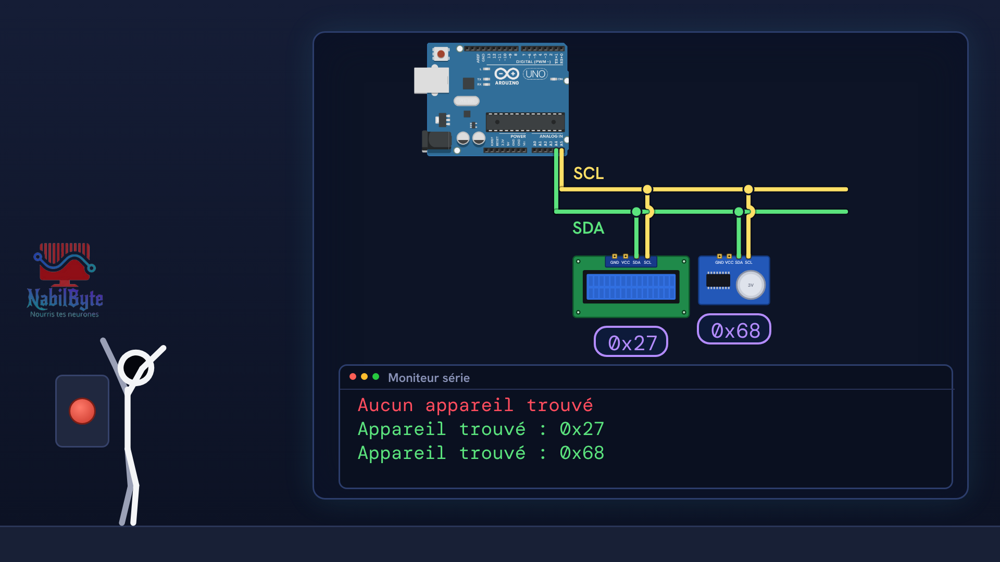

# Tutoriel Arduino n°22 : le protocole I2C expliqué simplement (SDA, SCL, adresses, ACK) 🔌

Le protocole I2C (ou I²C) permet à une carte Arduino de parler à plein d'appareils (écran LCD, horloge, capteurs…) avec seulement deux fils : SDA pour les données et SCL pour l'horloge. Dans ce tutoriel Arduino n°22, on comprend comment ça marche, puis on le vérifie avec un scanner I2C.

## Le montage

## La démo

## Le code

- [`arduino_i2c`](arduino_i2c/arduino_i2c.ino)

Carte : Arduino Uno. Dans l'IDE Arduino, ouvre le fichier `.ino` (le dossier du croquis garde le même nom que le fichier).

Animation et voix de synthèse de la chaîne NabilByte.
