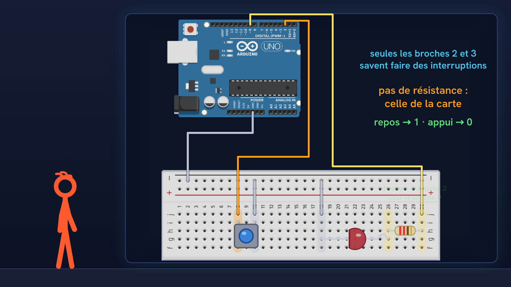
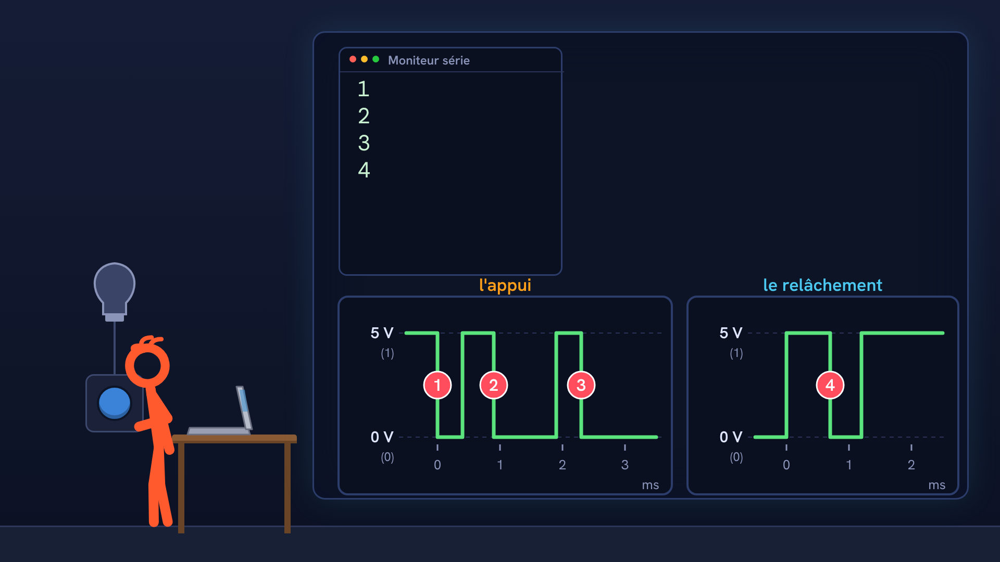
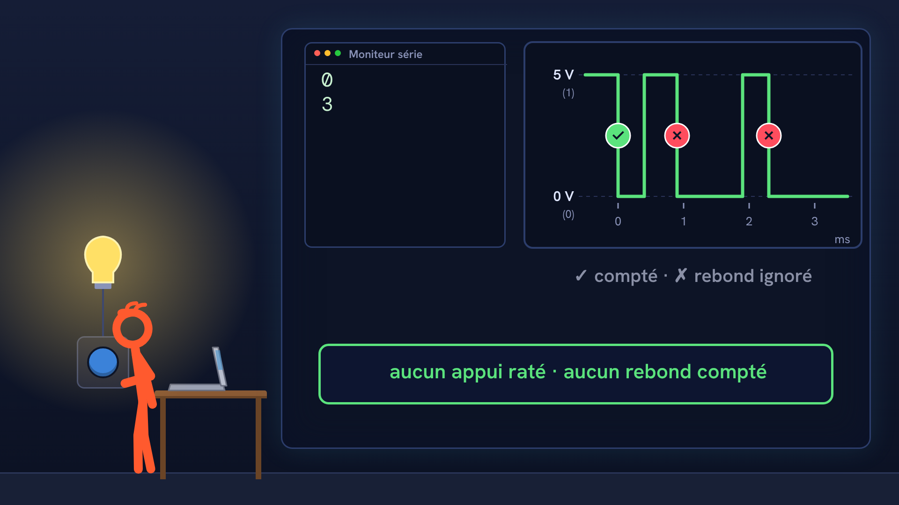

# Tutoriel Arduino n°41 : interruptions et rebonds d'un bouton (anti-rebond, attachInterrupt, volatile) 🔘

Tutoriel Arduino n°41 : on apprend à compter les appuis sur un bouton sans se tromper. Un bouton rebondit : un seul appui fait plusieurs changements sur la broche. On le prouve sur un signal, on le corrige avec un anti-rebond (millis), puis on utilise les interruptions (attachInterrupt) pour ne plus rien rater, même pendant un delay, avec volatile et noInterrupts. Pour les débutants : théorie, montage, code, et trois erreurs expliquées.

## Le montage

## La démo

## Le code

Dans l'ordre de la vidéo :

1. [`compteur_naif`](compteur_naif/compteur_naif.ino) : compte les descentes de la broche (un appui en compte 4).
2. [`compteur_antirebond`](compteur_antirebond/compteur_antirebond.ino) : ignore tout changement qui suit de moins de 50 ms le précédent.
3. [`compteur_avec_delay`](compteur_avec_delay/compteur_avec_delay.ino) : le même, avec un `delay(2000)` après chaque appui compté (les appuis rapides sont ratés).
4. [`compteur_interruption_brute`](compteur_interruption_brute/compteur_interruption_brute.ino) : `attachInterrupt` en mode `FALLING`, sans anti-rebond (trois appuis comptent 12).
5. [`compteur_interruptions`](compteur_interruptions/compteur_interruptions.ino) : **le programme final** : interruption en mode `CHANGE` avec anti-rebond, `volatile`, lecture protégée par `noInterrupts()` / `interrupts()`.

Carte : Arduino Uno. Dans l'IDE Arduino, ouvre le fichier `.ino` (le dossier du croquis garde le même nom que le fichier).

## Matériel

Arduino Uno, platine d'essai, bouton poussoir, LED, résistance 220 Ω, fils.

Animation et voix de synthèse de la chaîne NabilByte.
