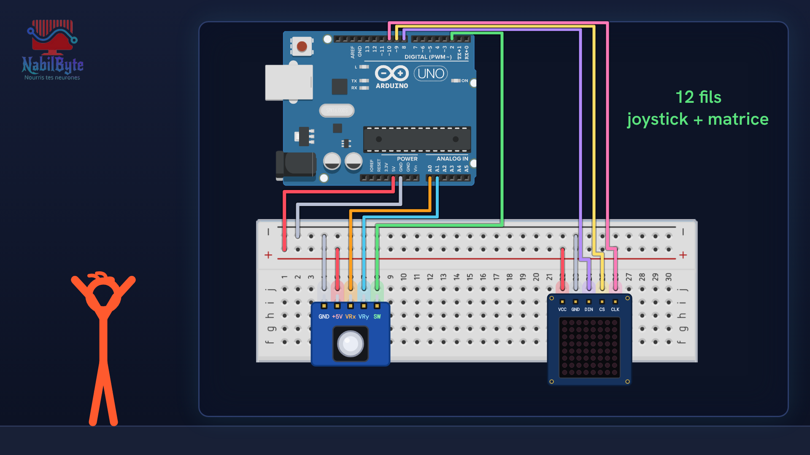
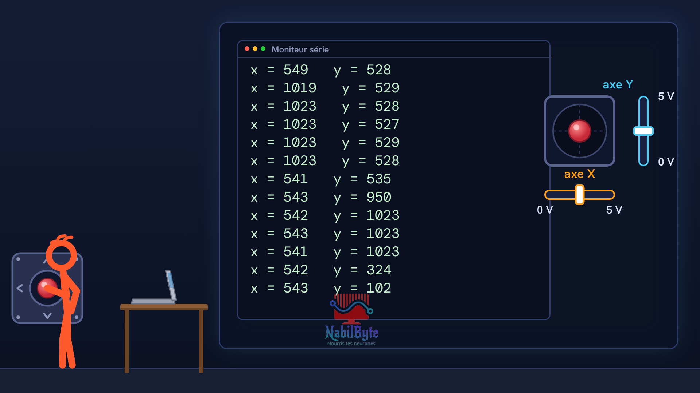
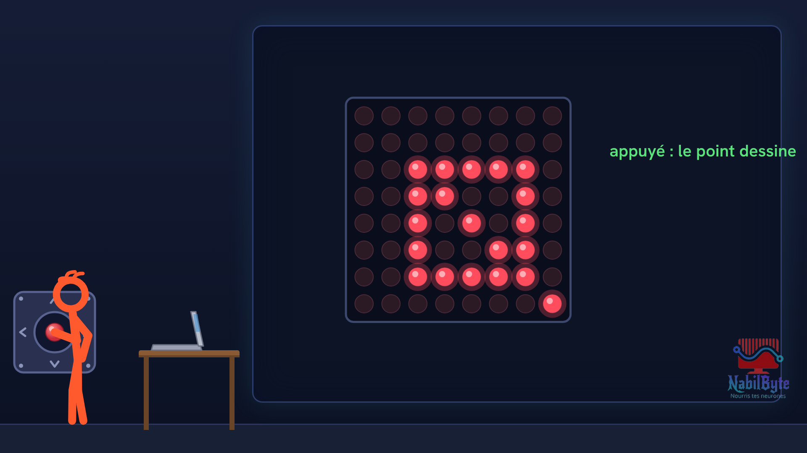

# Tutoriel Arduino n°40 : un joystick et un point lumineux (axes X et Y, zone morte, INPUT_PULLUP, matrice 8×8) 🕹️

Tutoriel Arduino n°40 : on fabrique une petite manette. Un joystick déplace un point de lumière sur une matrice de 64 LED, et en appuyant sur le manche, on dessine. Pour les débutants : théorie du joystick, montage, code, et trois essais ratés expliqués.

## Le montage

## La démo

## Le code

- [`joystick_1_lecture`](joystick_1_lecture/joystick_1_lecture.ino)
- [`joystick_2_direction`](joystick_2_direction/joystick_2_direction.ino)
- [`joystick_3_bouton`](joystick_3_bouton/joystick_3_bouton.ino)
- [`joystick_4_manette`](joystick_4_manette/joystick_4_manette.ino)

Carte : Arduino Uno. Dans l'IDE Arduino, ouvre le fichier `.ino` (le dossier du croquis garde le même nom que le fichier).

## Bibliothèques à installer

Gestionnaire de bibliothèques de l'IDE : « LedControl ».

## Matériel

Arduino Uno, module joystick (GND, +5V, VRx, VRy, SW), matrice de LED 8×8 MAX7219, platine d'essai, fils, bibliothèque LedControl.

Animation et voix de synthèse de la chaîne NabilByte.
