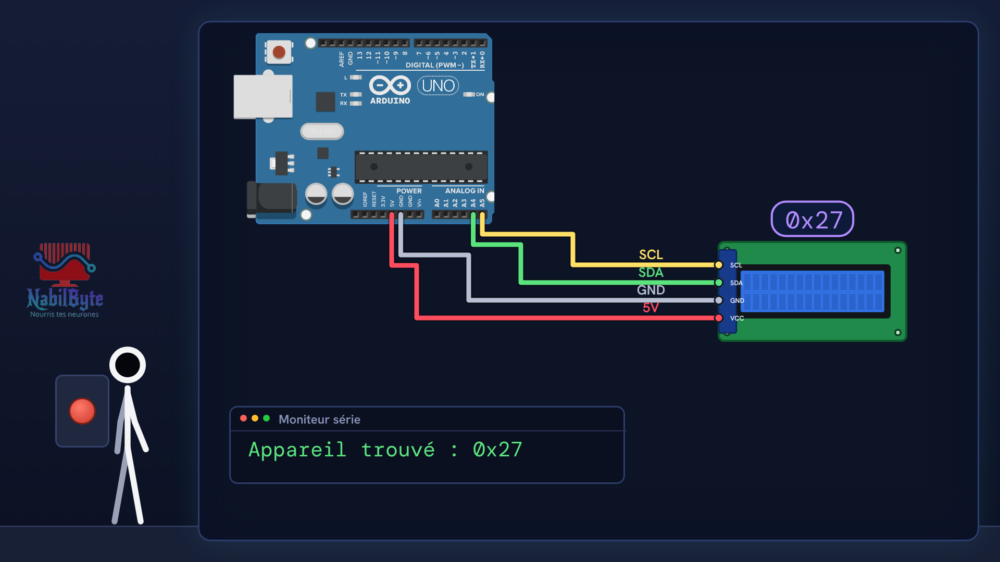
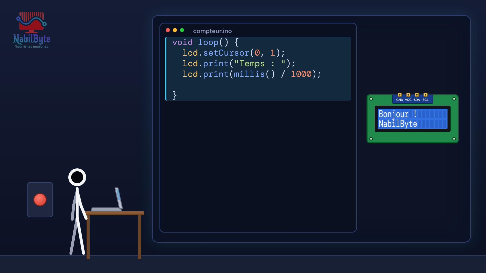
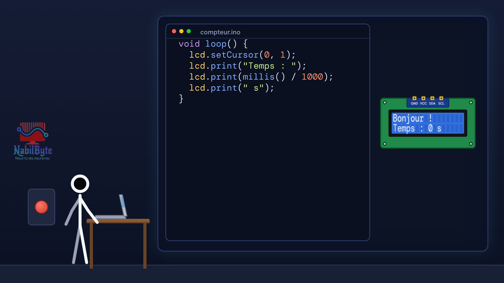

# Tutoriel Arduino n°23 : afficher du texte sur un écran LCD 16x2 en I2C 📟

Dans ce tutoriel Arduino n°23, on apprend à afficher du texte sur un écran LCD 16×2 (16 colonnes, 2 lignes) avec seulement quatre fils, grâce à l'adaptateur I2C. À la fin, l'écran affiche un compteur de secondes en direct.

## Le montage

## La démo

## Le code

- [`arduino_lcd`](arduino_lcd/arduino_lcd.ino)

Carte : Arduino Uno. Dans l'IDE Arduino, ouvre le fichier `.ino` (le dossier du croquis garde le même nom que le fichier).

## Bibliothèques à installer

Gestionnaire de bibliothèques de l'IDE : « LiquidCrystal I2C ».

Animation et voix de synthèse de la chaîne NabilByte.
