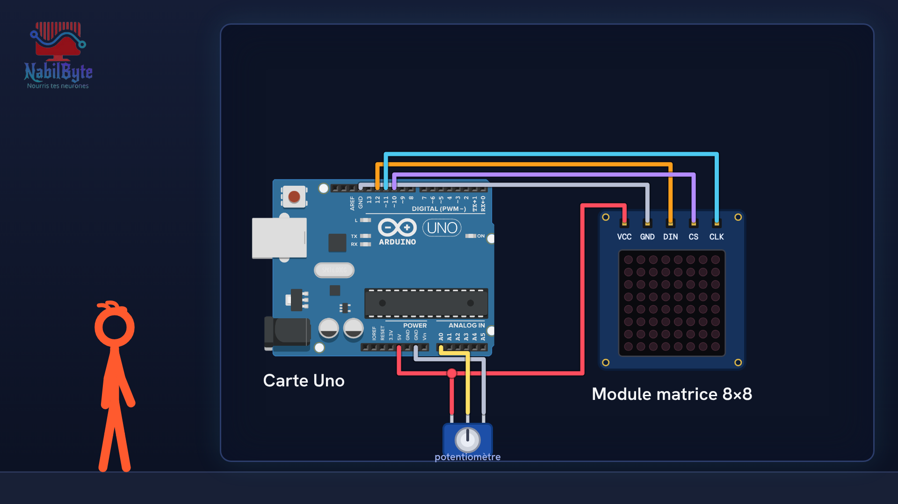
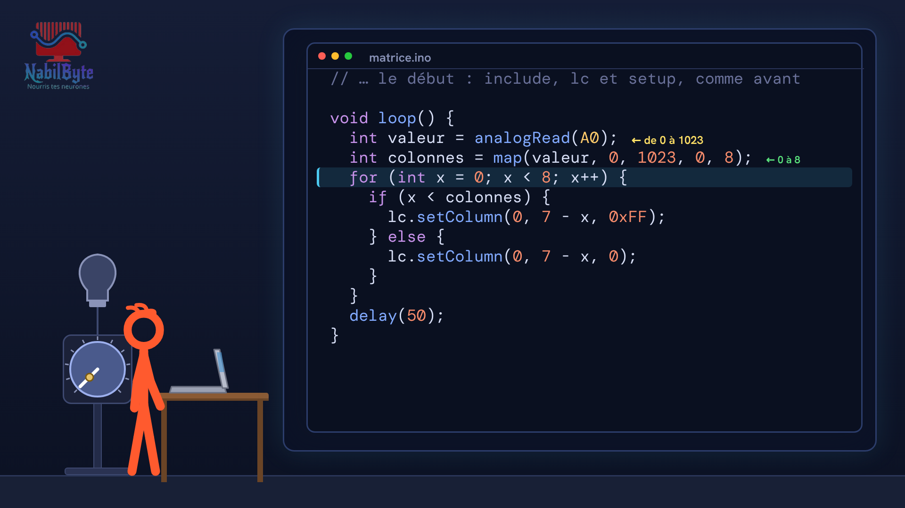
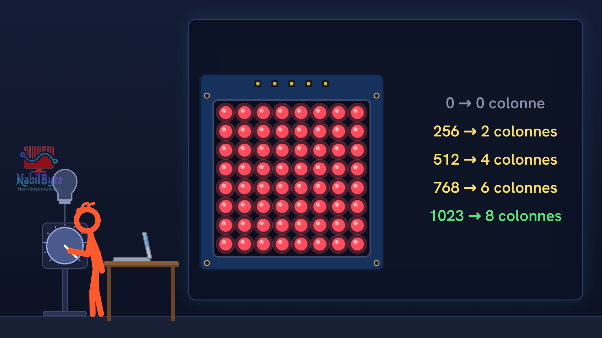

# Tutoriel Arduino n°31 : la matrice de LED 8×8 (MAX7219, LedControl, texte qui défile) 🔴

Dans ce tutoriel Arduino n°31, une carte Arduino Uno dessine sur une matrice de LED 8×8 : un cœur, une flèche, le mot SALUT qui défile, puis une barre commandée par un potentiomètre. Une vidéo pensée pour les débutants : la théorie d'abord, doucement, puis le montage et le code, avec deux essais ratés expliqués.

## Le montage

## La démo

## Le code

- [`arduino_matrice_led_1`](arduino_matrice_led_1/arduino_matrice_led_1.ino)
- [`arduino_matrice_led_2`](arduino_matrice_led_2/arduino_matrice_led_2.ino)

Carte : Arduino Uno. Dans l'IDE Arduino, ouvre le fichier `.ino` (le dossier du croquis garde le même nom que le fichier).

## Bibliothèques à installer

Gestionnaire de bibliothèques de l'IDE : « LedControl ».

Animation et voix de synthèse de la chaîne NabilByte.
