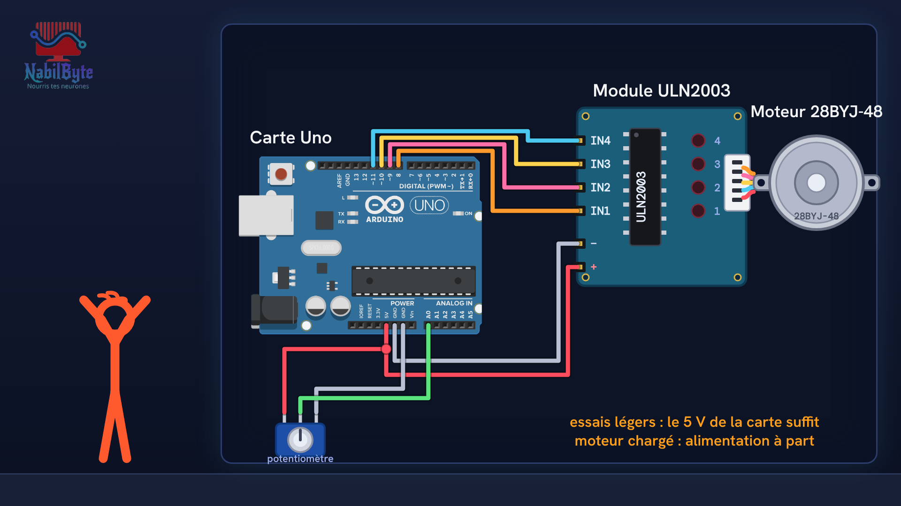

# Tutoriel Arduino n°34 : le moteur pas à pas 28BYJ-48, un cadran de précision (ULN2003, Stepper, step, setSpeed) ⚙️

Dans ce tutoriel Arduino n°34, une carte Arduino Uno pilote un moteur pas à pas 28BYJ-48 grâce à un module ULN2003 : l'aiguille du moteur suit un potentiomètre, comme un cadran de précision. Une vidéo pensée pour les débutants : la théorie d'abord, doucement, puis le montage et le code, avec trois essais ratés expliqués.

## Le montage

## La démo

## Le code

- [`arduino_moteur_pas_a_pas`](arduino_moteur_pas_a_pas/arduino_moteur_pas_a_pas.ino)

Carte : Arduino Uno. Dans l'IDE Arduino, ouvre le fichier `.ino` (le dossier du croquis garde le même nom que le fichier).

## Bibliothèques à installer

Gestionnaire de bibliothèques de l'IDE : « Stepper ».

Animation et voix de synthèse de la chaîne NabilByte.
