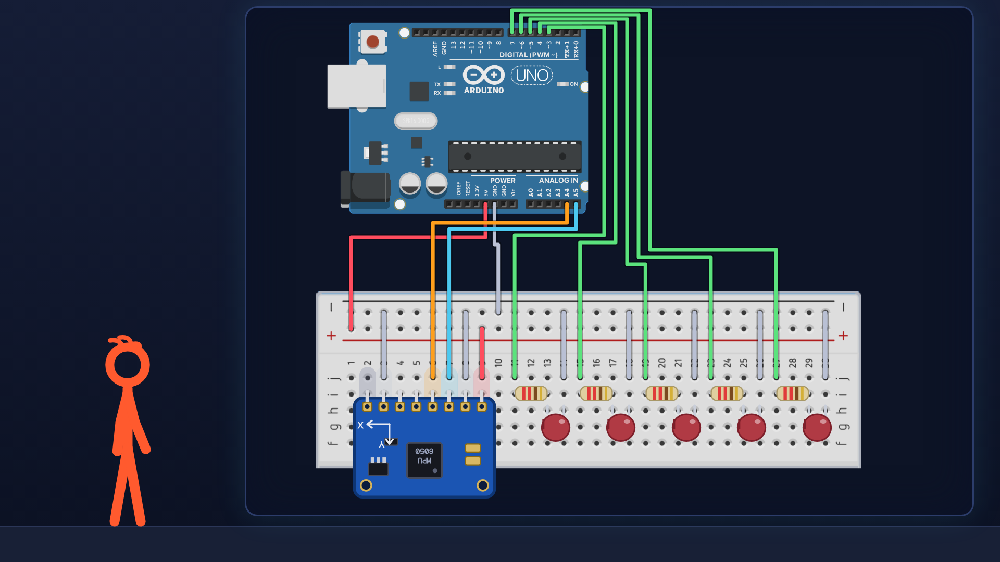
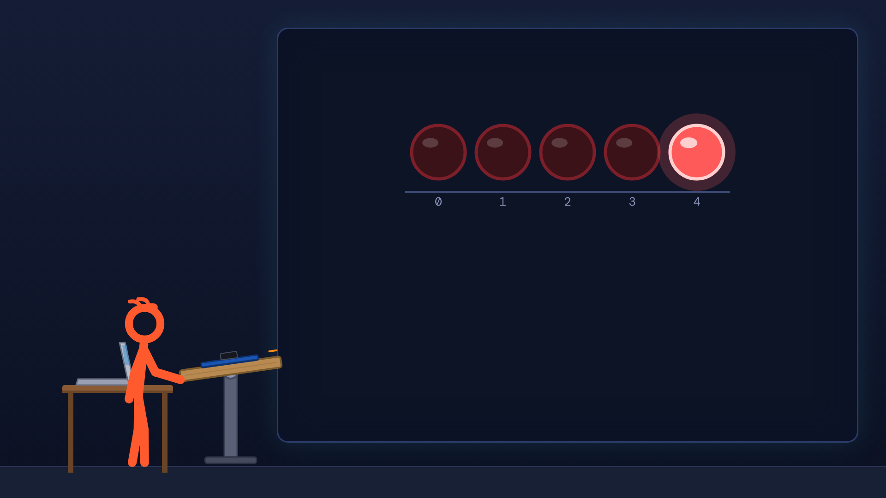
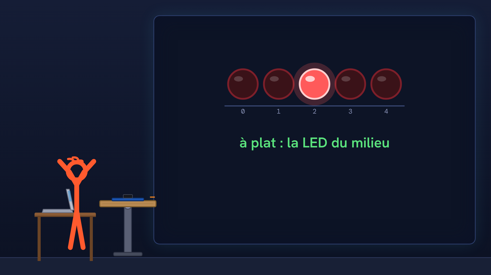

# Tutoriel Arduino n°50 : niveau à bulle électronique avec l'accéléromètre MPU6050 📐

Tutoriel Arduino n°50 : on fabrique un niveau à bulle électronique avec un accéléromètre MPU6050. Tu inclines une planchette, et une rangée de cinq LED montre la « bulle » qui glisse vers le côté le plus haut. Tu vois comment un accéléromètre sent la gravité (une masse sur des ressorts), pourquoi 1 g correspond à 16 384, comment calculer l'angle avec atan2 et degrees, puis comment lire le capteur en I2C. Pour les débutants : théorie, montage, code, et quatre erreurs expliquées (le capteur qui dort et ne renvoie que des zéros, le unsigned int qui transforme un nombre négatif en 63 006, l'angle qui tremble, le zéro à régler).

## Le montage

## La démo

## Le code

- [`niveau_angle`](niveau_angle/niveau_angle.ino)
- [`niveau_angle_lisse`](niveau_angle_lisse/niveau_angle_lisse.ino)
- [`niveau_bulle`](niveau_bulle/niveau_bulle.ino)
- [`niveau_final`](niveau_final/niveau_final.ino)
- [`niveau_lecture_brute`](niveau_lecture_brute/niveau_lecture_brute.ino)
- [`niveau_lecture_x`](niveau_lecture_x/niveau_lecture_x.ino)

Carte : Arduino Uno. Dans l'IDE Arduino, ouvre le fichier `.ino` (le dossier du croquis garde le même nom que le fichier).

## Matériel

carte Arduino Uno, platine d'essai, module MPU6050 (GY-521), 5 LED, 5 résistances 220 Ω, fils, une petite planchette pour fixer le module. Les nombres (X ≈ 690, Z ≈ 16 370, défaut de 2,4°) sont ceux de mon module : chez toi ils seront un peu différents. Le code compile pour une Uno ; le montage n'a pas été essayé sur une carte pour cette vidéo.

Animation et voix de synthèse de la chaîne NabilByte.
