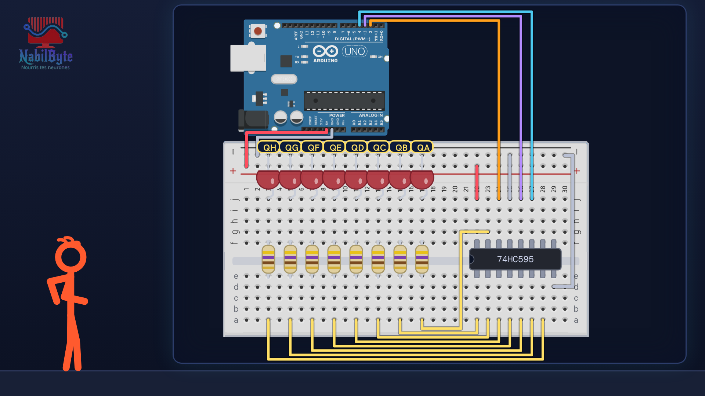
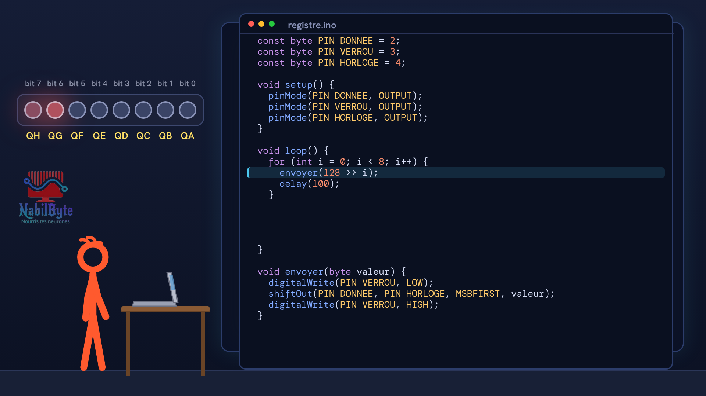
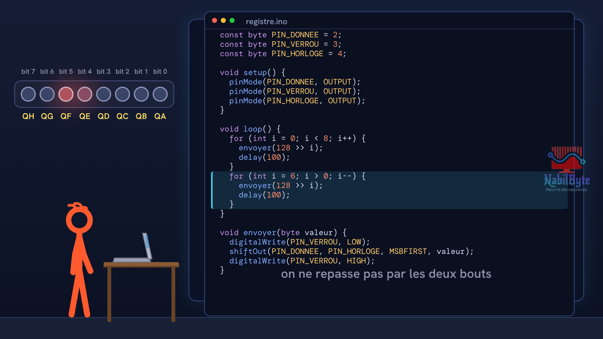

# Tutoriel Arduino n°46 : registre à décalage 74HC595, huit LED avec trois broches 💡

Tutoriel Arduino n°46 : on fait courir une lumière sur huit LED avec seulement trois broches de la carte, grâce au registre à décalage 74HC595. Tu vois comment des bits entrent un par un dans huit cases, pourquoi un verrou recopie tout d'un seul coup sur les sorties, comment câbler la puce et les huit LED sans dépasser le courant permis, ce que fait vraiment shiftOut, et comment relier deux puces pour seize sorties. Pour les débutants : théorie, montage, code, et trois erreurs expliquées (la patte MR laissée en l'air, le verrou tiré avant l'envoi, le chenillard qui court à l'envers).

## Le montage

## La démo

## Le code

- [`registre_a_la_main`](registre_a_la_main/registre_a_la_main.ino)
- [`registre_chenillard`](registre_chenillard/registre_chenillard.ino)
- [`registre_chenillard_envers`](registre_chenillard_envers/registre_chenillard_envers.ino)
- [`registre_deux_puces`](registre_deux_puces/registre_deux_puces.ino)
- [`registre_un_octet`](registre_un_octet/registre_un_octet.ino)
- [`registre_verrou_apres`](registre_verrou_apres/registre_verrou_apres.ino)
- [`registre_verrou_avant`](registre_verrou_avant/registre_verrou_avant.ino)

Carte : Arduino Uno. Dans l'IDE Arduino, ouvre le fichier `.ino` (le dossier du croquis garde le même nom que le fichier).

## Matériel

Arduino Uno, platine d'essai, registre à décalage 74HC595, 8 LED, 8 résistances 470 Ω, fils, câble USB. Vérifie les noms des pattes écrits dans le document de TA puce : ils changent un peu d'une marque à l'autre.

Animation et voix de synthèse de la chaîne NabilByte.
