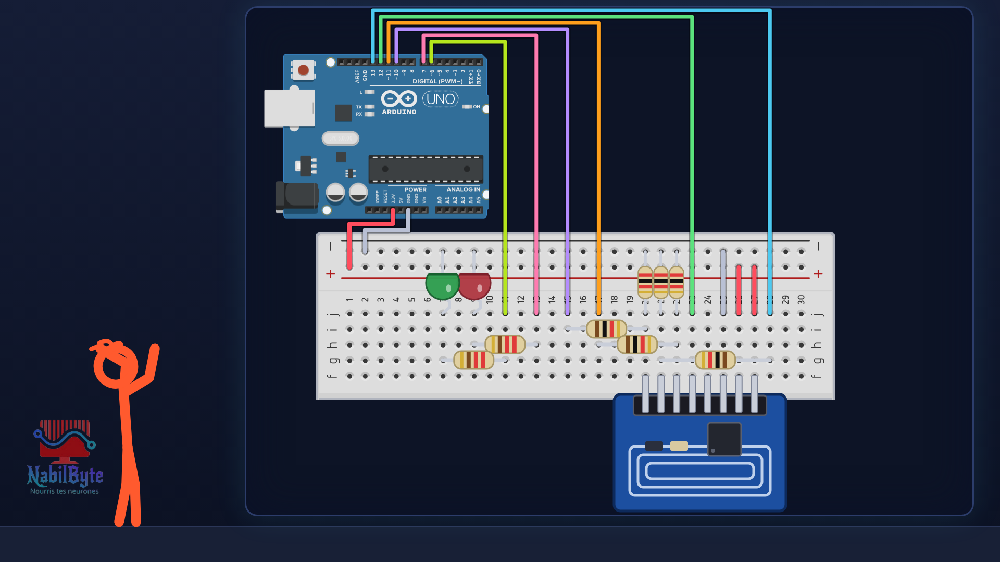
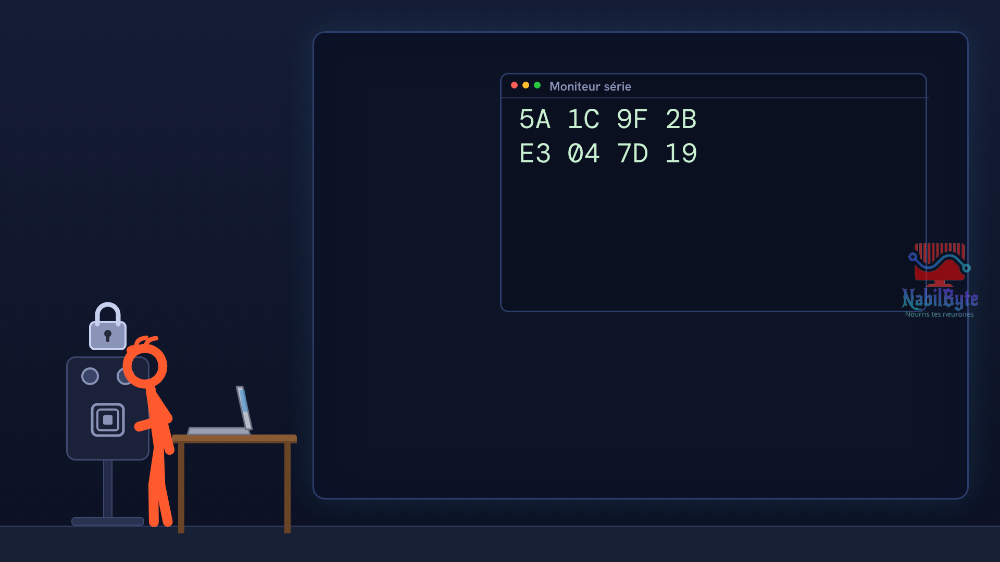
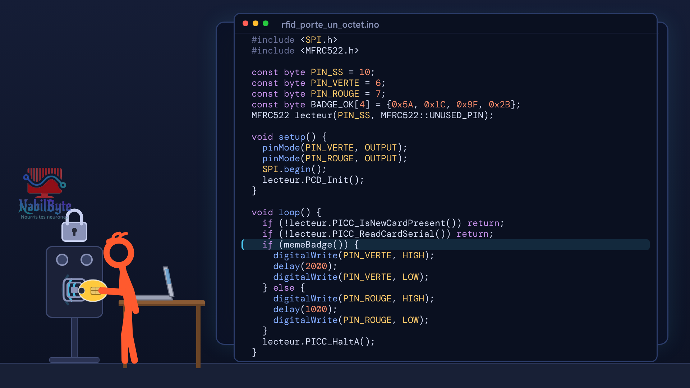

# Tutoriel Arduino n°47 : lecteur de badge RFID RC522, une serrure à badge 🔑

Tutoriel Arduino n°47 : on fabrique une serrure qui s'ouvre avec le bon badge, grâce au lecteur RFID RC522. Tu vois comment un badge sans pile répond à une onde radio, comment câbler le module (il fonctionne en 3,3 V, donc des diviseurs de tension sur les fils venant de la carte), comment lire l'identifiant (UID) du badge, et comment le comparer proprement au bon badge. Pour les débutants : théorie, montage, code, et trois erreurs expliquées (MOSI et MISO inversés, la comparaison de deux tableaux avec ==, un seul octet comparé).

## Le montage

## La démo

## Le code

- [`rfid_lire_uid`](rfid_lire_uid/rfid_lire_uid.ino)
- [`rfid_porte`](rfid_porte/rfid_porte.ino)
- [`rfid_porte_egal`](rfid_porte_egal/rfid_porte_egal.ino)
- [`rfid_porte_un_octet`](rfid_porte_un_octet/rfid_porte_un_octet.ino)
- [`rfid_version`](rfid_version/rfid_version.ino)

Carte : Arduino Uno. Dans l'IDE Arduino, ouvre le fichier `.ino` (le dossier du croquis garde le même nom que le fichier).

## Matériel

Arduino Uno, platine d'essai, module lecteur RFID RC522 avec son badge et son porte-clés, 2 LED (une verte, une rouge), 2 résistances 220 Ω, 3 résistances 1 kΩ, 3 résistances 2 kΩ, fils, câble USB. Bibliothèque à installer : MFRC522. Les numéros d'identifiant montrés sont des exemples : le tien sera différent.

Animation et voix de synthèse de la chaîne NabilByte.
