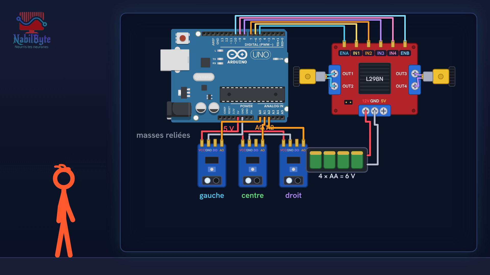
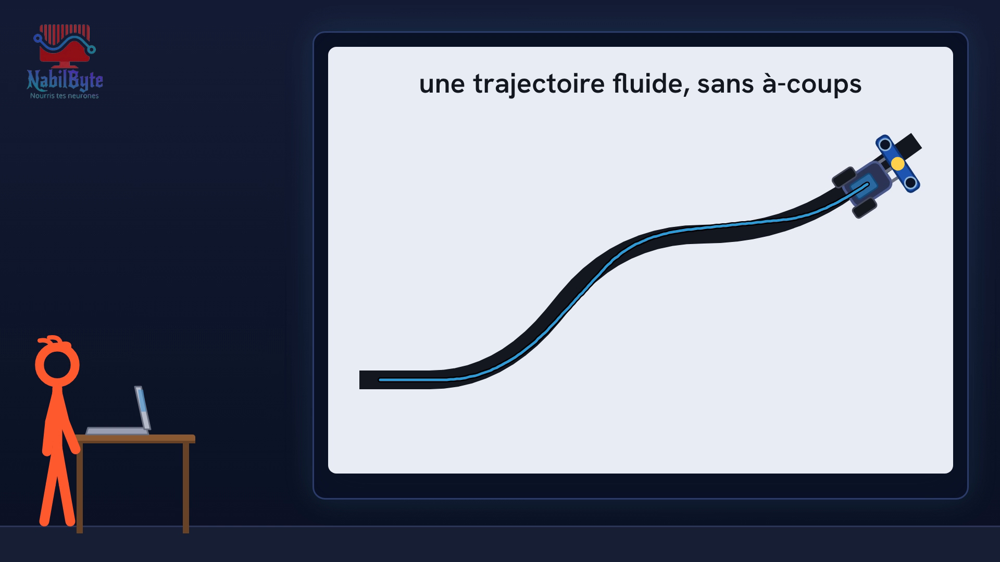
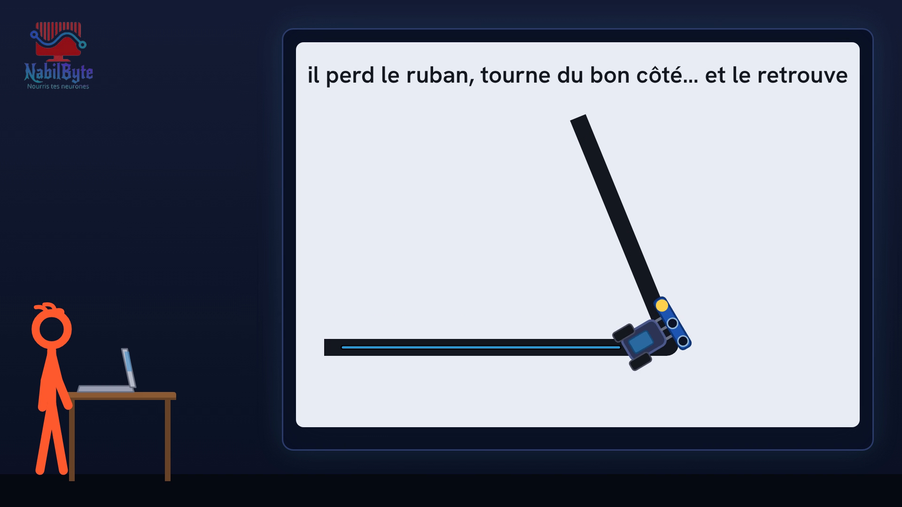

# Tutoriel Arduino n°51 : un robot suiveur de ligne avec trois capteurs infrarouges 🤖

Tutoriel Arduino n°51 : on fabrique un robot qui suit une ligne noire tout seul, avec trois capteurs infrarouges (TCRT5000), un pont en H et deux moteurs. Tu vois comment un capteur infrarouge distingue le noir du blanc (analogRead, seuil), comment décider quel moteur ralentir, pourquoi le tout ou rien zigzague, comment la correction proportionnelle (erreur, gain KP) rend la trajectoire fluide, et comment retrouver la ligne perdue en retenant le dernier côté où on l'a vue. Pour les débutants : théorie, montage, quatre programmes, et trois erreurs expliquées (capteurs trop hauts, vitesses à l'envers, ligne perdue dans un virage en épingle).

## Le montage

## La démo

## Le code

- [`lire_capteurs`](lire_capteurs/lire_capteurs.ino)
- [`suiveur_ligne_perdue`](suiveur_ligne_perdue/suiveur_ligne_perdue.ino)
- [`suiveur_proportionnel`](suiveur_proportionnel/suiveur_proportionnel.ino)
- [`suiveur_tout_ou_rien`](suiveur_tout_ou_rien/suiveur_tout_ou_rien.ino)

Carte : Arduino Uno. Dans l'IDE Arduino, ouvre le fichier `.ino` (le dossier du croquis garde le même nom que le fichier).

## Matériel

carte Arduino Uno, trois modules infrarouges TCRT5000 (sortie analogique AO), un module pont en H L298N, deux moteurs jaunes avec roues, un châssis, un boîtier de piles, fils, un ruban adhésif noir. Les nombres (blanc ≈ 100, noir ≈ 850, seuil 500) sont ceux de mon module : chez toi ils seront un peu différents, c'est ton moniteur série qui donne les bons. Les quatre programmes compilent pour une Uno ; le robot n'a pas été essayé sur une vraie piste pour cette vidéo.

Animation et voix de synthèse de la chaîne NabilByte.
