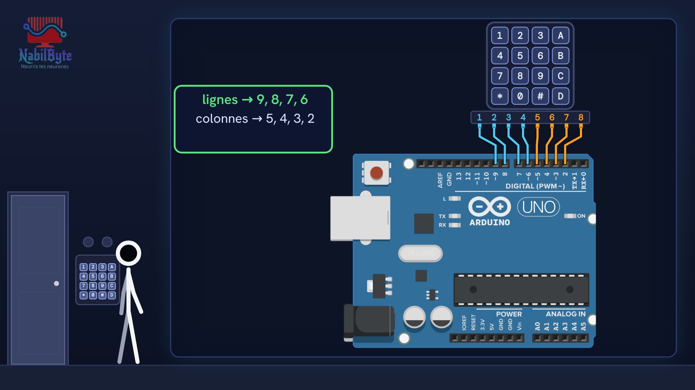
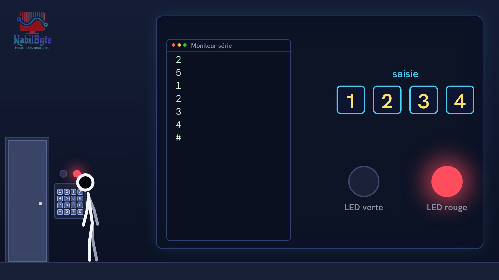
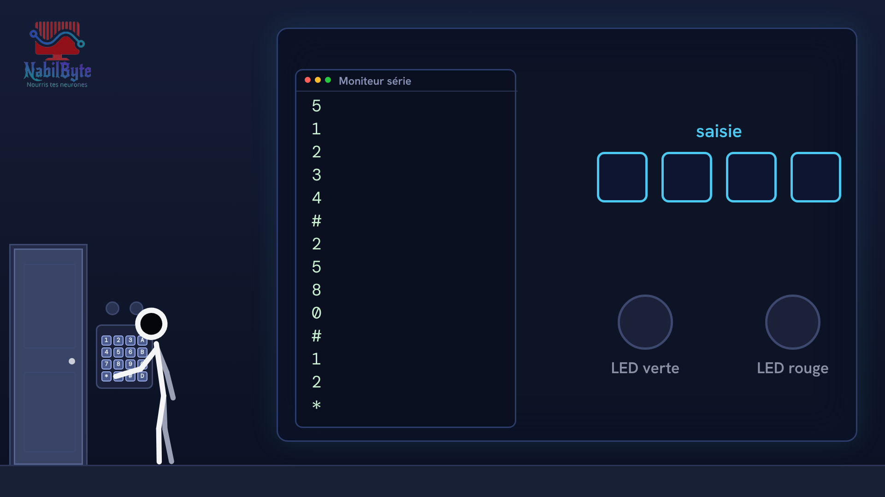

# Tutoriel Arduino n°27 : une serrure à code (clavier 4×4, balayage, bibliothèque Keypad) 🔐

Dans ce tutoriel Arduino n°27, on fabrique une serrure à code : on tape un code secret sur un clavier à 16 touches, et si le code est bon, la LED verte s'allume et la porte s'ouvre (sinon, c'est la LED rouge). Une vidéo pensée pour les débutants, où chaque notion est expliquée doucement avant d'être utilisée.

## Le montage

## La démo

## Le code

- [`arduino_serrure_code`](arduino_serrure_code/arduino_serrure_code.ino)

Carte : Arduino Uno. Dans l'IDE Arduino, ouvre le fichier `.ino` (le dossier du croquis garde le même nom que le fichier).

## Bibliothèques à installer

Gestionnaire de bibliothèques de l'IDE : « Keypad ».

Animation et voix de synthèse de la chaîne NabilByte.
