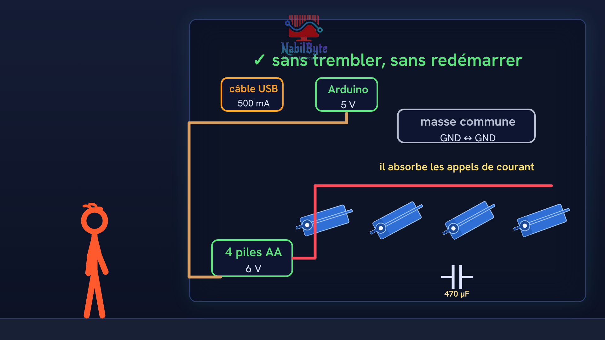
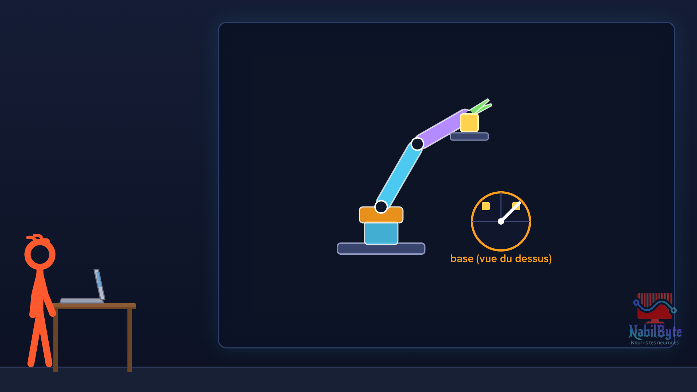
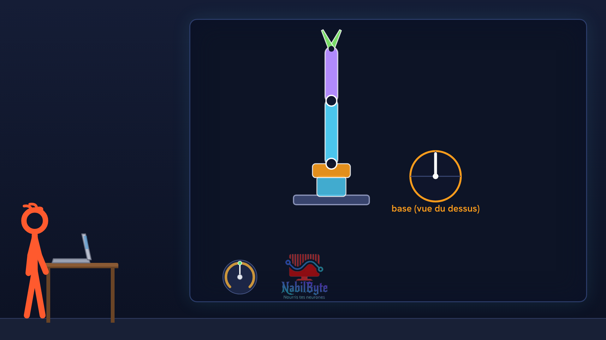

# Tutoriel Arduino n°52 : piloter plusieurs servomoteurs avec un bras robot 🦾

Tutoriel Arduino n°52 : on pilote plusieurs servomoteurs SG90 avec une carte Arduino Uno, et on s'en sert pour animer un bras de robot à quatre articulations (base, épaule, coude, pince). Tu vois comment un servo reçoit son angle (une impulsion de 1 à 2 ms, cinquante fois par seconde), comment en brancher plusieurs avec la bibliothèque Servo, des tableaux et des boucles, pourquoi quatre servos sur le 5 V de l'USB font redémarrer la carte (alimentation séparée, masse commune, condensateur), comment les piloter avec quatre potentiomètres (analogRead, map), comment les faire bouger en douceur avec millis, et comment enchaîner des poses pour que le bras prenne un objet et le dépose. Pour les débutants : théorie, montage, cinq programmes, et une erreur expliquée (l'alimentation).

## Le montage

## La démo

## Le code

- [`bras_mouvement_doux`](bras_mouvement_doux/bras_mouvement_doux.ino)
- [`bras_potentiometres`](bras_potentiometres/bras_potentiometres.ino)
- [`bras_sequence`](bras_sequence/bras_sequence.ino)
- [`quatre_servos_positions`](quatre_servos_positions/quatre_servos_positions.ino)
- [`un_servo_balayage`](un_servo_balayage/un_servo_balayage.ino)

Carte : Arduino Uno. Dans l'IDE Arduino, ouvre le fichier `.ino` (le dossier du croquis garde le même nom que le fichier).

## Matériel

carte Arduino Uno, quatre micro-servos SG90, quatre potentiomètres, quatre piles AA avec boîtier (ou une alimentation 5 V, 2 A), un condensateur de 470 µF, une platine d'essai, des fils, et un bras de robot (kit ou imprimé en 3D). Les cinq programmes compilent pour une Uno ; le bras n'a pas été essayé sur un vrai montage pour cette vidéo.

Animation et voix de synthèse de la chaîne NabilByte.
