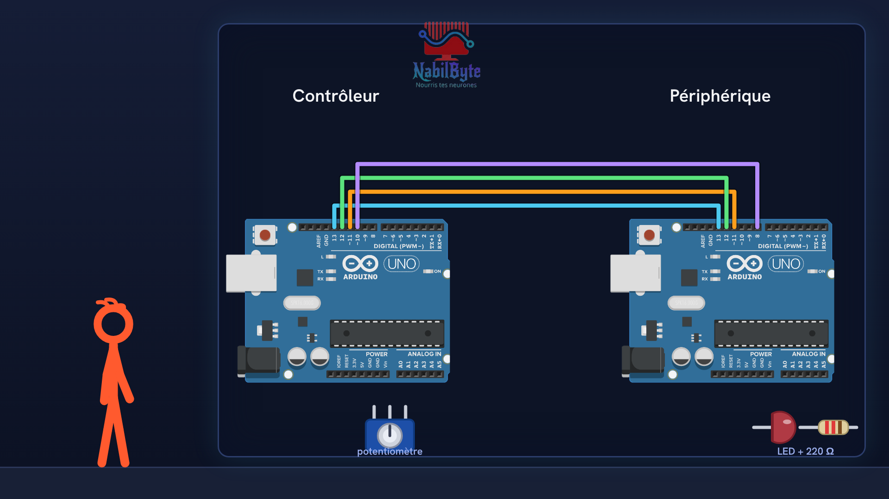
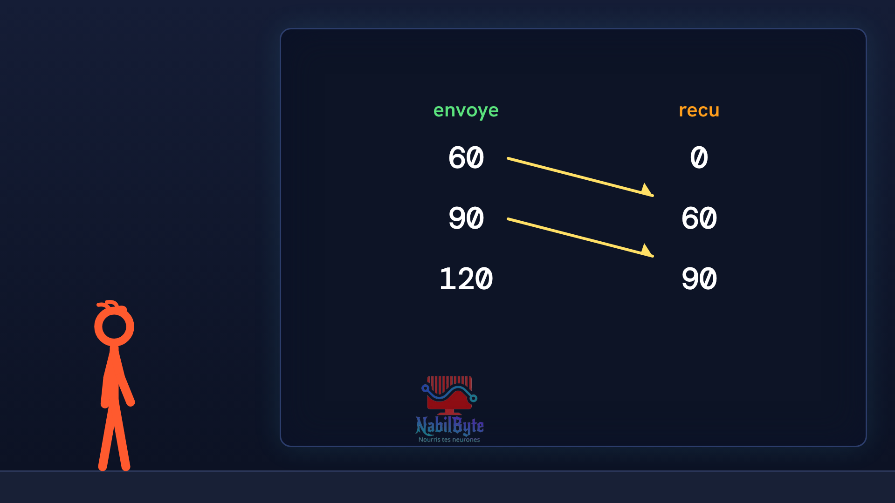
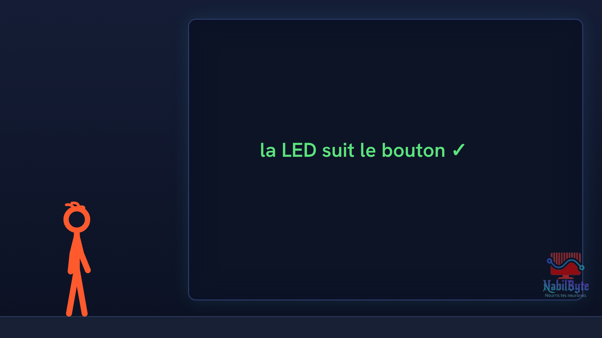

# Tutoriel Arduino n°29 : le bus SPI, deux cartes Arduino qui se parlent (SCK, MOSI, MISO, SS) 🔌

Dans ce tutoriel Arduino n°29, deux cartes Arduino Uno se parlent en SPI : un potentiomètre sur la première règle la luminosité d'une LED sur la seconde. Une vidéo pensée pour les débutants : la théorie d'abord, doucement, puis le montage et le code, avec un essai raté expliqué.

## Le montage

## La démo

## Le code

- [`arduino_spi_1`](arduino_spi_1/arduino_spi_1.ino)
- [`arduino_spi_2`](arduino_spi_2/arduino_spi_2.ino)

Carte : Arduino Uno. Dans l'IDE Arduino, ouvre le fichier `.ino` (le dossier du croquis garde le même nom que le fichier).

Animation et voix de synthèse de la chaîne NabilByte.
