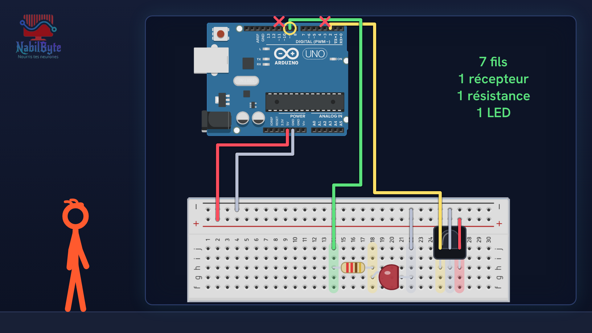
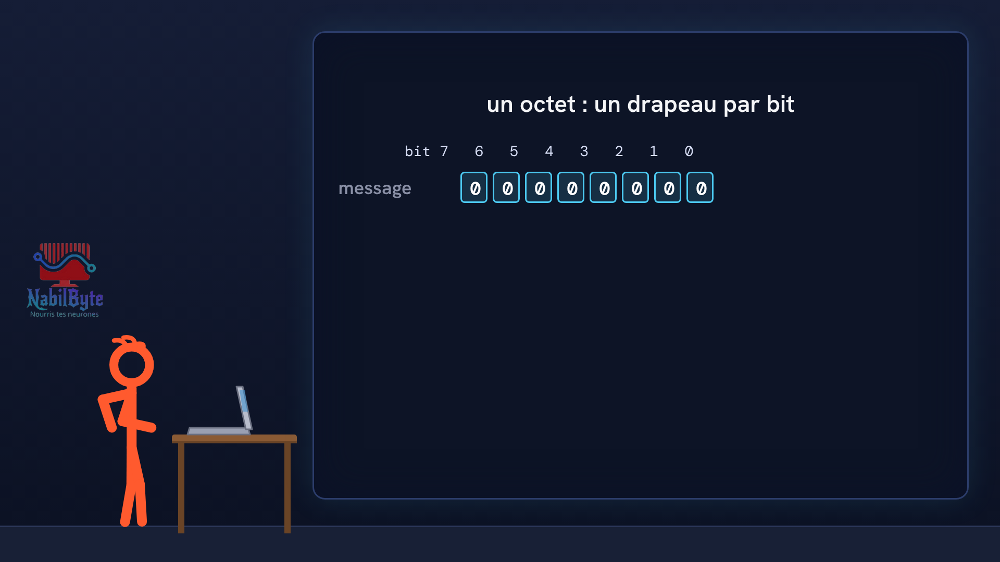
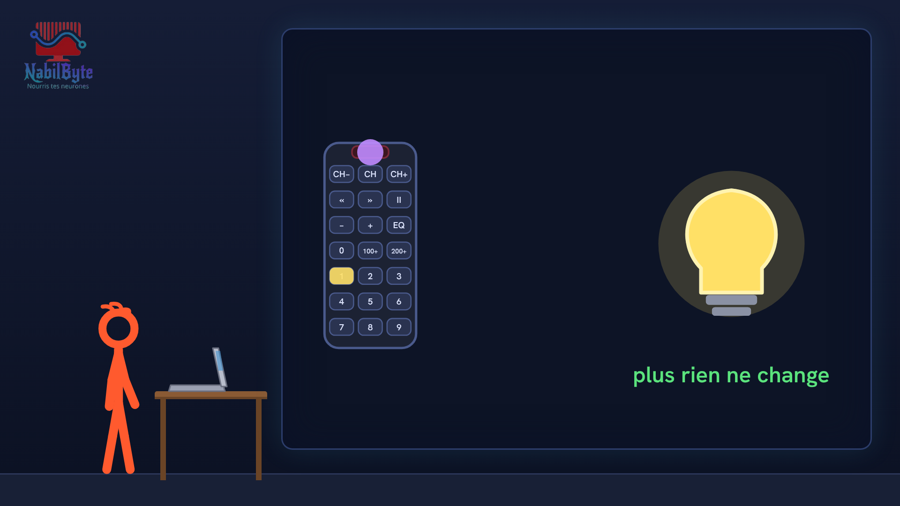

# Tutoriel Arduino n°33 : la télécommande infrarouge, commander une LED sans fil (VS1838B, IRremote, protocole NEC) 📡

Dans ce tutoriel Arduino n°33, une carte Arduino Uno reçoit les ordres d'une télécommande infrarouge grâce à un récepteur VS1838B : la touche 1 allume et éteint une LED, les touches + et − règlent sa luminosité. Une vidéo pensée pour les débutants : la théorie d'abord, doucement, puis le montage et le code, avec deux essais ratés expliqués.

## Le montage

## La démo

## Le code

- [`arduino_telecommande_ir_1`](arduino_telecommande_ir_1/arduino_telecommande_ir_1.ino)
- [`arduino_telecommande_ir_2`](arduino_telecommande_ir_2/arduino_telecommande_ir_2.ino)

Carte : Arduino Uno. Dans l'IDE Arduino, ouvre le fichier `.ino` (le dossier du croquis garde le même nom que le fichier).

## Bibliothèques à installer

Gestionnaire de bibliothèques de l'IDE : « IRremote ».

Animation et voix de synthèse de la chaîne NabilByte.
