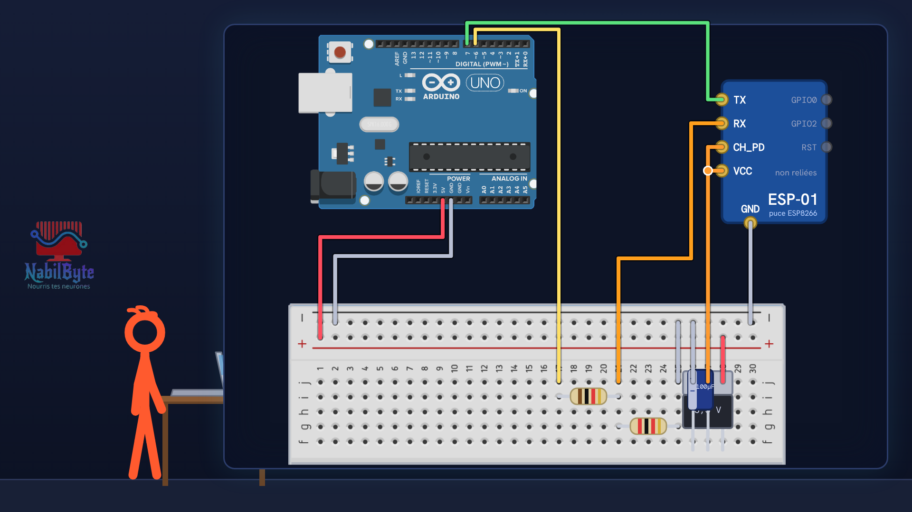
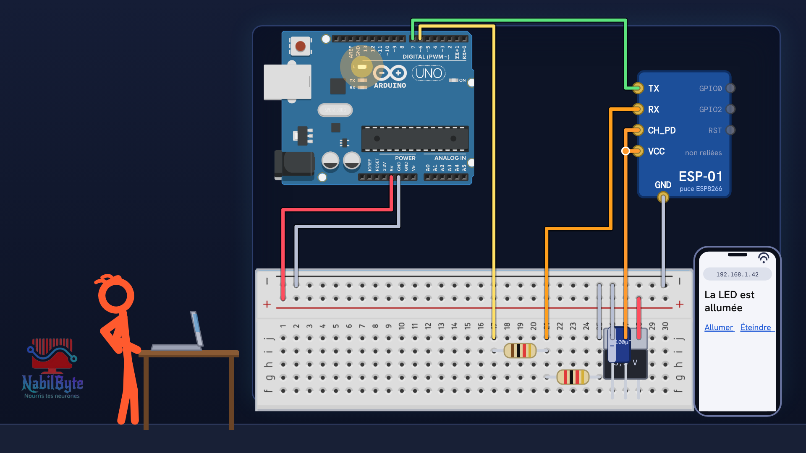
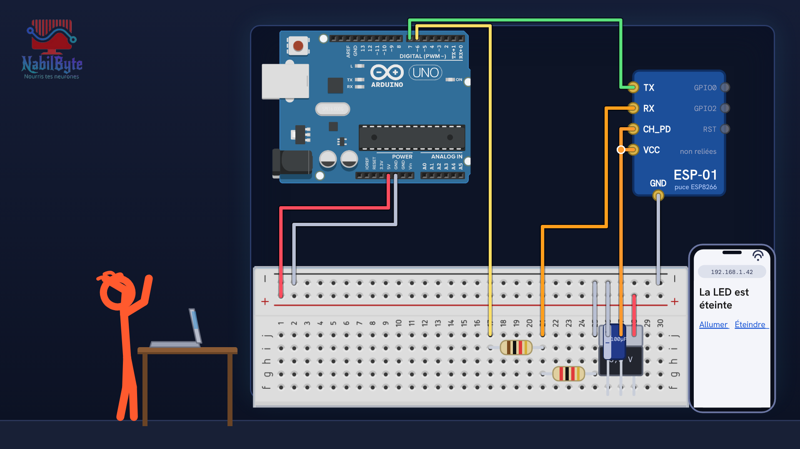

# Tutoriel Arduino n°44 : Uno + module ESP-01, une page web pour allumer une LED en Wi-Fi 📶

Tutoriel Arduino n°44 : la carte Uno n'a pas de Wi-Fi, mais avec un petit module ESP-01 à quelques euros elle peut servir une page web et allumer une LED depuis un téléphone. Tu vois comment marche le module (commandes AT), les trois pièges d'un module en 3,3 V (tension des signaux, courant, vitesse), le montage avec diviseur de tension et régulateur, le réglage de la vitesse, la bibliothèque WiFiEsp, le serveur et la page de commande, et la mémoire de la Uno. Pour les débutants : théorie, montage, code, et quatre erreurs expliquées (CH_PD oublié, alimentation trop faible, mauvaise vitesse, page blanche « OK »).

## Le montage

## La démo

## Le code

- [`regler_vitesse_module`](regler_vitesse_module/regler_vitesse_module.ino)
- [`test_at_module`](test_at_module/test_at_module.ino)
- [`wifi_connexion`](wifi_connexion/wifi_connexion.ino)
- [`wifi_page_commande`](wifi_page_commande/wifi_page_commande.ino)

Carte : Arduino Uno + module ESP-01 avec le micrologiciel AT (version 0.25 ou plus : `AT+GMR` l'affiche). Le module est alimenté en 3,3 V par son propre régulateur (condensateur 100 µF), et le signal Uno → RX passe par un diviseur de tension 1 kΩ / 2 kΩ. Règle d'abord la vitesse du module avec `regler_vitesse_module` (une seule fois ; `AT+UART_DEF`, ou `AT+CIOBAUD` sur un ancien micrologiciel). Vérifie les noms des broches écrits sur ton module. Remplace `MaBox` et `motdepasse` par le nom (2,4 GHz) et le mot de passe de ton Wi-Fi. Programmes compilés pour la Uno, non essayés sur une carte.

## Bibliothèques à installer

Gestionnaire de bibliothèques de l'IDE : « WiFiEsp ».

## Matériel

carte Arduino Uno, platine d'essai, module ESP-01 (firmware AT), régulateur 3,3 V (type AMS1117-3.3 ou LD1117), condensateur 100 µF, résistances 1 kΩ et 2 kΩ, fils, câble USB, un téléphone et le Wi-Fi de la maison (2,4 GHz). Vérifie les noms des broches écrits sur TON module : l'ordre change selon les modèles.

Animation et voix de synthèse de la chaîne NabilByte.
