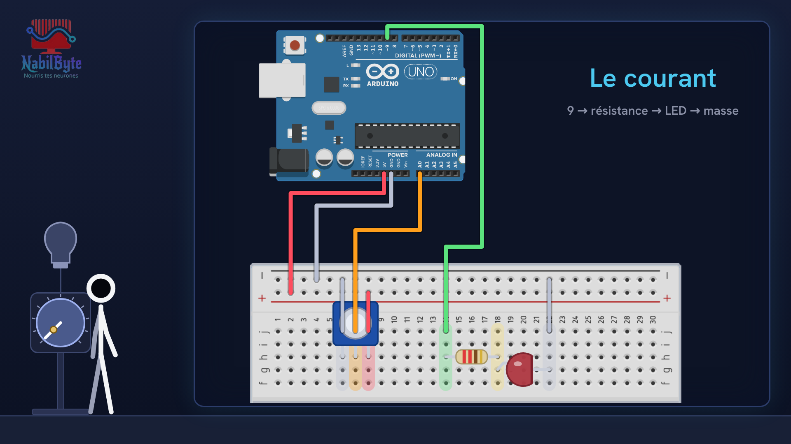
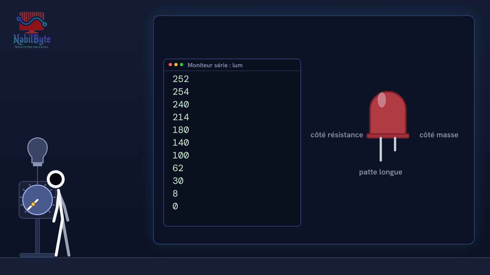
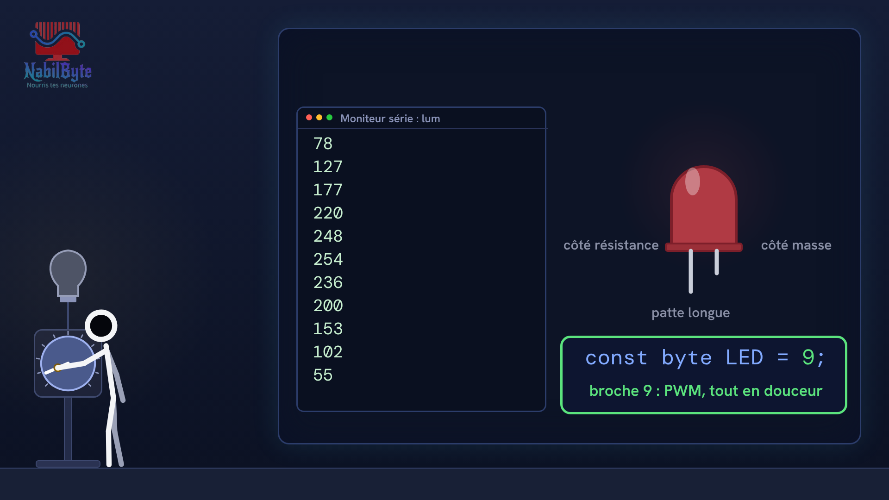

# Tutoriel Arduino n°26 : un variateur de lumière (potentiomètre, analogRead, PWM, map) 💡

Dans ce tutoriel Arduino n°26, on fabrique un variateur de lumière, tout doucement et pas à pas : on tourne un potentiomètre, et une LED s'éclaire plus ou moins fort. Une vidéo pensée pour les débutants, où chaque notion est expliquée avant d'être utilisée.

## Le montage

## La démo

## Le code

- [`arduino_variateur`](arduino_variateur/arduino_variateur.ino)

Carte : Arduino Uno. Dans l'IDE Arduino, ouvre le fichier `.ino` (le dossier du croquis garde le même nom que le fichier).

Animation et voix de synthèse de la chaîne NabilByte.
