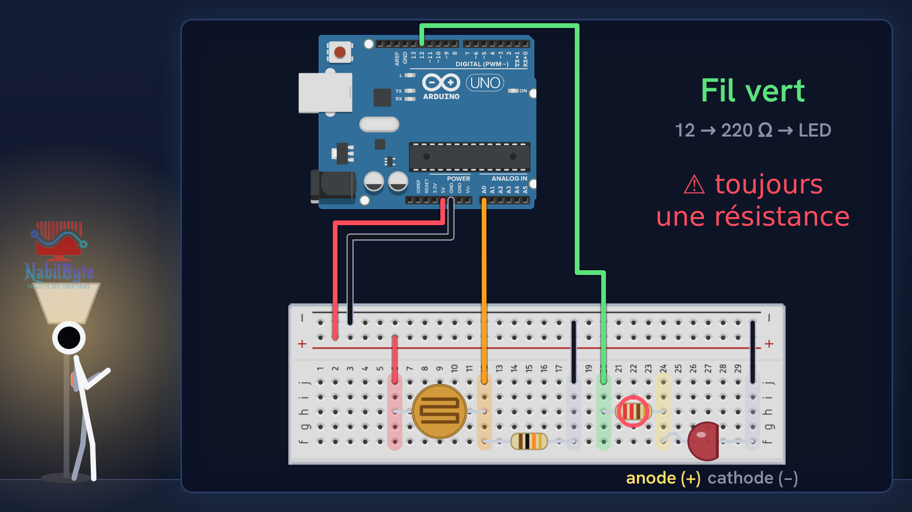
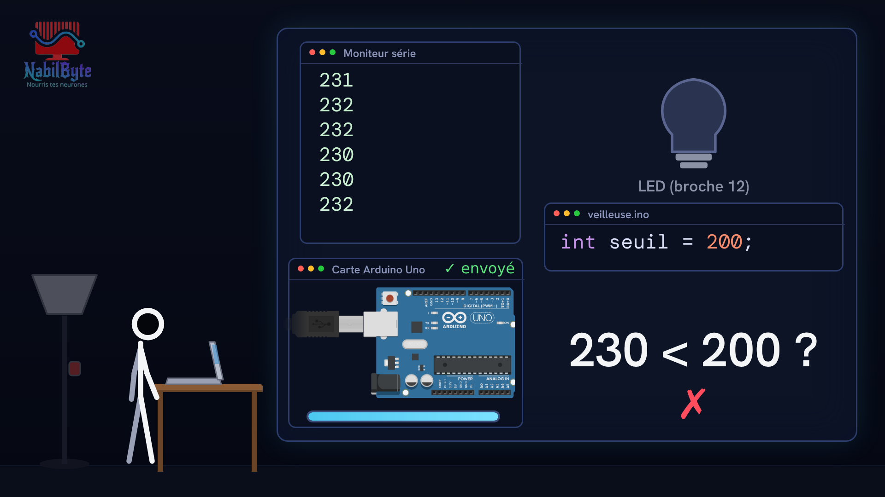
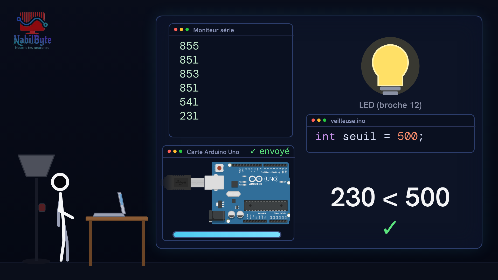

# Tutoriel Arduino n°21 : une veilleuse automatique avec une photorésistance 💡

Dans ce tutoriel Arduino n°21, on fabrique une veilleuse automatique : une LED qui s'allume toute seule quand la nuit tombe et s'éteint quand le jour se lève, avec une carte Arduino Uno et une photorésistance.

## Le montage

## La démo

## Le code

- [`arduino_veilleuse`](arduino_veilleuse/arduino_veilleuse.ino)

Carte : Arduino Uno. Dans l'IDE Arduino, ouvre le fichier `.ino` (le dossier du croquis garde le même nom que le fichier).

## Matériel

carte Arduino Uno, photorésistance, LED, résistance 10 kΩ, résistance 220 Ω, platine d'essai, câble USB, fils.

Animation et voix de synthèse de la chaîne NabilByte.
