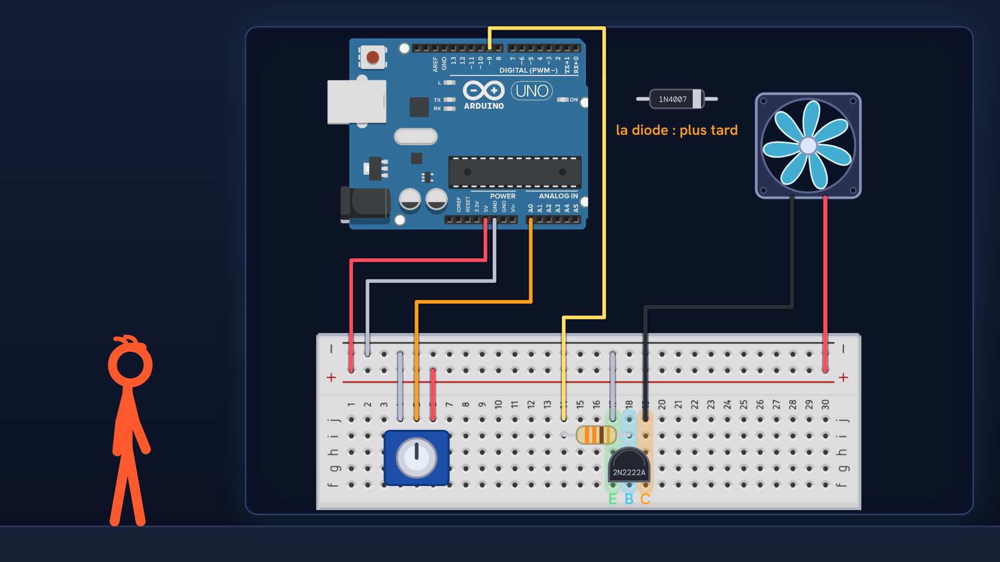
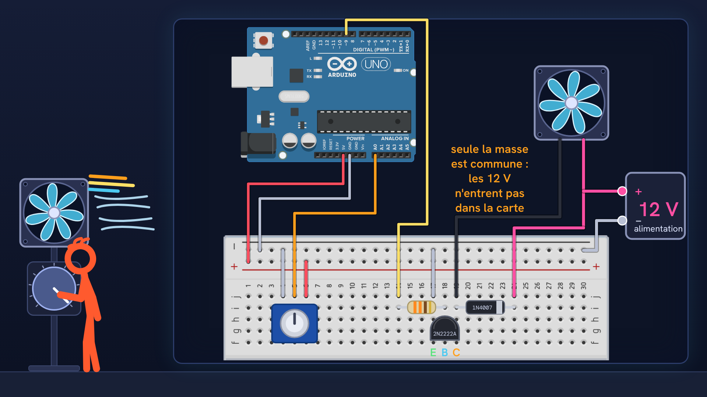

# Tutoriel Arduino n°42 : un ventilateur avec un transistor (courant d'une broche, diode de roue libre, PWM) 🌀

Tutoriel Arduino n°42 : on fabrique un ventilateur dont on règle la vitesse avec un potentiomètre. Une broche de la carte ne donne que 20 mA : on voit pourquoi un transistor est indispensable, comment calculer sa résistance de base, pourquoi une diode de roue libre protège le montage, et comment le PWM règle la vitesse. Pour les débutants : théorie, montage, code, et quatre erreurs expliquées (moteur sur une broche, démarrage, diode oubliée, masse commune).

## Le montage

## La démo

## Le code

- [`essai_broche_directe`](essai_broche_directe/essai_broche_directe.ino) : l'essai raté du début (ventilateur branché directement sur la broche 9). **À ne pas refaire avec un vrai moteur** : une broche ne donne que 20 mA.
- [`ventilateur_vitesse`](ventilateur_vitesse/ventilateur_vitesse.ino) : le premier programme, la vitesse suit le potentiomètre.
- [`ventilateur_demarrage`](ventilateur_demarrage/ventilateur_demarrage.ino) : la version finale, avec le coup de fouet au démarrage et la zone morte sous 20.

## Le câblage en bref

- Potentiomètre : une patte au GND, une patte au 5 V, le curseur à `A0`.
- Transistor 2N2222A (boîtier plastique, face plate vers toi : émetteur, base, collecteur) : émetteur au GND, base à la broche 9 par une résistance de 330 Ω, collecteur au fil noir du ventilateur.
- Ventilateur 5 V : fil rouge au 5 V, fil noir au collecteur.
- Diode 1N4007 en parallèle du ventilateur : bande grise (cathode) du côté du plus, l'autre patte au collecteur.
- Ventilateur 12 V : fil rouge et bande de la diode au plus de l'alimentation de 12 V, et le moins de cette alimentation relié au GND de la carte (masse commune). Les 12 V n'entrent jamais dans la carte.

Carte : Arduino Uno. Dans l'IDE Arduino, ouvre le fichier `.ino` (le dossier du croquis garde le même nom que le fichier).

## Matériel

Arduino Uno, platine d'essai, potentiomètre, petit ventilateur 5 V (200 mA), transistor 2N2222A, résistance 330 Ω, diode 1N4007, fils ; en option, un ventilateur 12 V et son alimentation.

Animation et voix de synthèse de la chaîne NabilByte.
