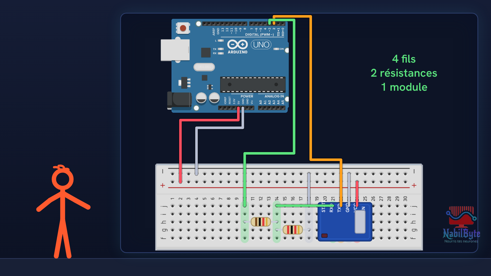
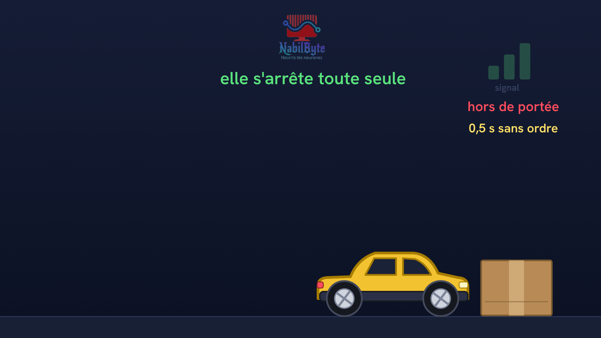

# Tutoriel Arduino n°38 : une voiture télécommandée avec Bluetooth (pont en H, L298N, HC-05, moteurs) 🚗

Dans ce tutoriel Arduino n°38, on fabrique une voiture télécommandée : un téléphone envoie un ordre par Bluetooth, et la voiture avance, recule ou pivote. Avec une carte Arduino Uno, un module de puissance L298N (pont en H), deux moteurs jaunes à engrenages, un module Bluetooth HC-05 et un boîtier de piles. Une vidéo pensée pour les débutants : la théorie d'abord, doucement, puis le montage et le code, avec trois essais ratés expliqués.

## Le montage

## La démo

## Le code

- [`arduino_voiture_telecommandee`](arduino_voiture_telecommandee/arduino_voiture_telecommandee.ino)

Carte : Arduino Uno. Dans l'IDE Arduino, ouvre le fichier `.ino` (le dossier du croquis garde le même nom que le fichier).

## Matériel

carte Arduino Uno, module de puissance L298N, deux moteurs jaunes à engrenages avec roues, châssis de voiture avec roue libre, boîtier de 4 piles AA, module Bluetooth HC-05, résistances de 1 kΩ et de 2 kΩ, platine d'essai, fils, batterie USB pour la carte, téléphone Android avec une application de télécommande série (boutons qui envoient F, B, L, R, S).

Animation et voix de synthèse de la chaîne NabilByte.
